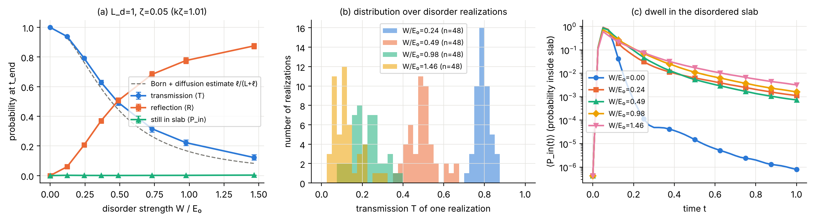
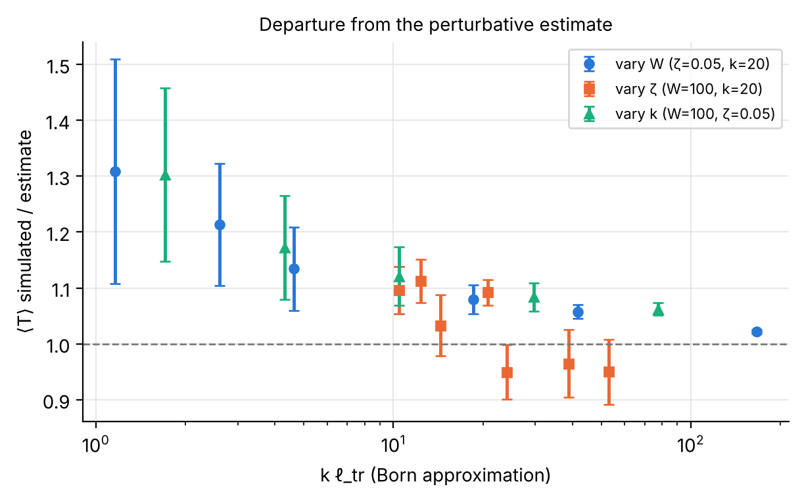
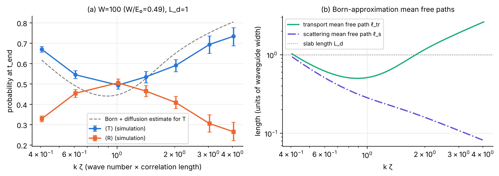
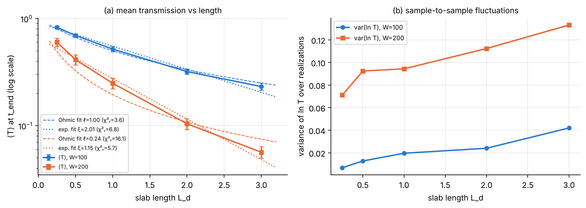
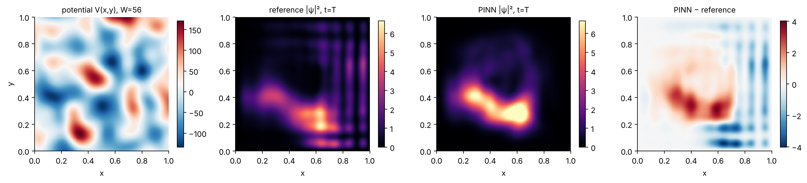

# Quantum Wave Dynamics in Disordered Potential Landscapes

A computational quantum-physics project on how **static, spatially
correlated disorder** affects the propagation, scattering, transmission and
reflection of a quantum wave packet in two dimensions. It also looks at
whether localization can be detected at the accessible system sizes. Two
independent solvers are used for the time-dependent Schrödinger equation:

* a **classical spectral split-step solver** (DST-based, validated against
  exact solutions and by convergence tests). All physics experiments use it.
* a **physics-informed neural network (PINN)**. It is evaluated on the same
  disordered potentials (identical realizations) to find out where PINNs are
  reliable and where they fail.

The main contribution is the **physical investigation** and an honest
**method assessment**. No new neural-network architecture or new
mathematical result is claimed. See [docs/LITERATURE.md](docs/LITERATURE.md)
for the literature, the research gap, and the line between established
knowledge and this project's own results.

> Project history: an earlier version used an open-quantum-system
> motivation that the model does not implement (it has no environment or
> dephasing). That framing has been removed, and the project is now about
> unitary dynamics in static disorder. An audit of the earlier version,
> which found that its main results were not supported, is in
> [docs/AUDIT.md](docs/AUDIT.md).

---

## 1. Research question

> **How do the strength W and the spatial correlation length ζ of a
> Gaussian-correlated random potential control the transmission and
> reflection of a quantum wave packet through a finite disordered region
> of a 2D waveguide? Are the observed trends consistent with
> perturbative (Born-approximation) transport theory, and can
> localization be distinguished from finite-size effects at the accessible
> system sizes?**

Secondary (methodological) question: *how accurate is a PINN solution of
the same disordered 2D TDSE, compared with a validated classical solver,
and what limits it?*

## 2. Scientific motivation

Disorder is everywhere: impurities in conductors, roughness in waveguides,
random optical (speckle) potentials for cold atoms. Waves that scatter many
times off a random potential interfere. Depending on the disorder strength,
its correlation length and the dimensionality, transport can be
**ballistic**, **diffusive**, or suppressed by **Anderson localization**
(Anderson 1958; Abrahams et al. 1979; Lee & Ramakrishnan 1985). Correlated
disorder matters in practice: speckle potentials have a finite grain size,
and the ratio of grain size to wavelength (kζ) controls how strongly and in
which directions a wave is scattered (Kuhn et al. 2007).

Simulating the time-dependent dynamics directly lets us watch these
processes and measure transmission statistics over many disorder
realizations. The theory used for comparison is established. The
numerical experiment tests where its perturbative predictions hold for a
specific, finite geometry.

## 3. Physical model

Dimensionless units with ħ = m = 1. The wavefunction ψ(x, y, t) obeys

$$ i\,\partial_t\psi = -\tfrac12\left(\partial_x^2+\partial_y^2\right)\psi + V(x,y)\,\psi $$

on a rectangle [0, L_x] × [0, L_y] with **hard walls** (ψ = 0 on the
boundary). Lengths are in units of the waveguide width.

Two geometries are used (`config.py`):

| Geometry | Used for | Domain | Initial state | Boundaries |
|---|---|---|---|---|
| **Open waveguide** (`waveguide_config`) | transport experiments | L_y = 1, L_x = 2.9 + L_d | Gaussian packet in transverse mode 1, k_x0 = 20, σ_x = 0.2 | hard walls in y; complex absorbing potentials (CAPs) at both x-ends |
| **Closed box** (`closed_box_config`) | spreading / localization diagnostics | L × L, L ∈ {1, 2} | 2D Gaussian, k_x0 = 20, σ = 0.08 | hard walls |
| **PINN problem** (`pinn_config`) | PINN vs reference | 1 × 1, t ∈ [0, 0.02] | 2D Gaussian at (0.35, 0.5), k_x0 = 15, σ = 0.07 | hard walls |

Waveguide numbers: k = (k_x0² + π²)^{1/2} ≈ 20.25, E₀ = k²/2 ≈ 205,
wavelength ≈ 0.31, **N = 6 open transverse channels**. The disorder occupies
the slab 1.9 < x < 1.9 + L_d (default L_d = 1).

### Real/imaginary form (used by the PINN)

With ψ = u + iv, the equation splits into two coupled real PDEs:

$$ f_u \equiv \partial_t u + \tfrac12\nabla^2 v - V v = 0, \qquad f_v \equiv \partial_t v - \tfrac12\nabla^2 u + V u = 0. $$

### Initial conditions (`initial_condition.py`)

* 2D Gaussian: ψ₀ = (π σ_x σ_y)^{-1/2} exp[−(x−x₀)²/2σ_x² − (y−y₀)²/2σ_y²] e^{i(k_x0 x + k_y0 y)}
* Waveguide mode: ψ₀ = (π σ_x²)^{-1/4} e^{−(x−x₀)²/2σ_x²} e^{i k_x0 x} · (2/L_y)^{1/2} sin(π y / L_y)

Both are normalized to 1 (checked on the box to < 10⁻⁶ by the tests). The
momentum spread is σ_k = 1/(√2 σ_x).

### Conservation law

Without absorbing layers the dynamics is unitary: ∫|ψ|² dx dy = 1 for all t.
With CAPs, the probability removed at each end is recorded exactly, so
**T + R + P_in = 1** holds to rounding error (validation V6).

## 4. Disorder generation (`disorder.py`)

The disorder is a **continuum** random field defined by a seed, the RMS
strength W and the correlation length ζ:

$$ V_{\rm dis}(\mathbf r) = W\sqrt{\tfrac{2}{M}}\sum_{j=1}^{M}\cos(\mathbf q_j\cdot\mathbf r+\varphi_j)\;S(x),\qquad \mathbf q_j\sim\mathcal N(0,\zeta^{-2}\mathbb 1_2),\ \ \varphi_j\sim U[0,2\pi) $$

with M = 512 modes and an optional smooth slab window
S(x) = ½[tanh((x−a)/δ) − tanh((x−b)/δ)], δ = 0.02. This is the
spectral-representation method of Shinozuka & Deodatis (1991). Averaged
over the ensemble, for **any** M:

$$ \langle V_{\rm dis}\rangle = 0,\qquad \langle V_{\rm dis}(\mathbf r)V_{\rm dis}(\mathbf r')\rangle = W^2 e^{-|\mathbf r-\mathbf r'|^2/2\zeta^2}. $$

The power spectrum is S(q) = 2πW²ζ² e^{−q²ζ²/2}. Individual realizations
are **not** re-normalized, so the ensemble statistics stay exactly as
stated.

Properties (all tested in `tests/test_potential.py`):
* the **same seed gives the same physical field at any grid resolution**;
* NumPy (reference solver) and PyTorch (PINN) evaluations **agree
  pointwise** to < 10⁻⁹ relative in float64;
* the field is differentiable, so it can be used inside the PINN residual;
* the ensemble mean, variance and correlation function match the
  definition within sampling error (3000 realizations).

Optional deterministic barrier (`potential.py`): a strip of height V_b and
width w with tanh edges, or a sharp step when the edge width is zero.

### Perturbative benchmark (Born approximation)

For a particle with wave number k in unbounded 2D Gaussian-correlated
disorder, Fermi's golden rule gives (`disorder.born_rates`, with
a = k²ζ²):

$$ \frac{1}{\tau_s}=2\pi W^2\zeta^2 e^{-a}I_0(a),\qquad \frac{1}{\tau_{tr}}=2\pi W^2\zeta^2e^{-a}\left[I_0(a)-I_1(a)\right],\qquad \ell_{s,tr}=k\,\tau_{s,tr}. $$

These hold only for weak disorder (kℓ ≫ 1) and ignore the waveguide's
discrete channels, so they serve as **order-of-magnitude benchmarks**. A
simple diffusive estimate of the slab transmission is
T ≈ ℓ/(L_d + ℓ) with ℓ = (π/2)ℓ_tr. This is an order-of-magnitude form,
not a fit.

## 5. Classical reference solver (`reference_solver.py`)

Strang split-step propagation (Strang 1968; Feit, Fleck & Steiger 1982)
using a **2D type-I discrete sine transform**. Sine modes sin(nπx/L) are
the eigenfunctions of the Dirichlet Laplacian, so the kinetic step is exact
for the sine-series representation and ψ = 0 on the walls holds by
construction. The scheme is second order in Δt and spectrally accurate in
space. A CAP W(x) = W₀ s² (s = depth into a 0.6-wide layer, W₀ = 300)
absorbs outgoing waves. Several disorder realizations are propagated as a
batch.

The reference solver is **not assumed to be exact**. Its accuracy is
measured in Section 7.

## 6. PINN (`model.py`, `pinn_core.py`, `train.py`)

* MLP with 4 hidden layers of 64 tanh units. Inputs are normalized to
  [0, 1] (x/L_x, y/L_y, t/T), followed by an optional Fourier-feature
  embedding (6 linearly spaced frequencies from 1 to 6 cycles per unit;
  Tancik et al. 2020).
* **Hard constraints**: u = u₀ + A·B(x,y)·τ·N_u and v = v₀ + A·B·τ·N_v,
  with B = 16 x̂(1−x̂)ŷ(1−ŷ) and τ = t/T. The initial condition holds
  exactly. The Dirichlet condition holds up to |ψ₀| on the walls
  (< 4×10⁻⁵).
* Loss: mean squared **scaled** residual (T/A)·(f_u, f_v), plus a
  normalization penalty (∫|ψ|² − 1)² at random times.
* Collocation: a fresh uniform batch of 4000 points **every Adam step**, or
  residual-adaptive sampling (RAD; Wu et al. 2023). Optional causal time
  weighting (Wang, Sankaran & Perdikaris 2024).
* Optimizers: Adam (2000 steps, lr 10⁻³ halved every 1000 steps, linear
  PDE-weight warm-up over 300 steps, gradient clipping), then 200 L-BFGS
  iterations on a fixed set of 16000 points.
* The potential is the same `Potential` object (same disorder realization)
  that the reference solver uses.

**Training-protocol note (a finding, not a tuning choice).** The original
recipe used a fixed set of 4000 collocation points and finished with L-BFGS
on fixed points. On the PINN problem it reached a training residual of
9×10⁻⁴, but the residual on 20000 fresh points was 0.22, and the solution
error was 1.22, worse than predicting ψ = 0 (`results/pinn/diag_fixed_points_lbfgs`).
The network had **overfitted its collocation points**. Drawing a fresh batch
at every Adam step gives similar training and held-out residuals
(5.7×10⁻³ vs 9.3×10⁻³), and this protocol is used for all study runs.
Causal weighting (ε = 1) was tried and did not help at this budget
(`diag_stochastic_causal`: 0.57 vs 0.49).

## 7. Numerical validation (`validate_solver.py` → `results/validation/`)

All numbers below come from `results/validation/*.csv`
(figure: `figures/validation_solver.png`).

| Check | Setting | Result |
|---|---|---|
| V1 exact eigenmode (constant V = 50) | 63², Δt = 10⁻⁴, t ≤ 0.1 | max \|error\| = 4.6×10⁻¹⁴ (exact to rounding, as expected) |
| V2 analytic free Gaussian | 127² and 255², Δt = 10⁻⁴ and 2×10⁻⁵, t ≤ 0.01 | relative L2 error ≤ 9.4×10⁻¹⁰ |
| V3 Δt convergence, PINN problem with W = E₀ | 127², error vs Δt = 1.25×10⁻⁶ | observed order 2.0; **Δt = 10⁻⁵ (production): 5.3×10⁻⁷** |
| V3 Δt convergence, waveguide with W = 200 | dx = 1/64, t = 1 | order 2; **Δt = 2×10⁻⁴ (production): \|ΔT\| = 2.0×10⁻⁵, \|ΔR\| = 2.3×10⁻⁵** |
| V4 spatial convergence, waveguide W = 200, ζ = 0.02 and 0.05 | same continuum disorder on dx = 1/32, 1/64, 1/128 | **dx = 1/64 (production): \|ΔT\| ≤ 1.4×10⁻⁵**; dx = 1/32: ≤ 2×10⁻³ |
| V4 spatial convergence, PINN problem W = E₀ | 31² … 255² | **127² (production): 1.9×10⁻⁶** relative L2 |
| V5 CAP spurious return (clean waveguide) | vs incident k_x0 | 1.0×10⁻⁴ (k = 20), 1.6×10⁻⁴ (25), 5×10⁻⁴ (30), 1.3×10⁻³ (16), **1.3×10⁻² (12), 3.1×10⁻² (10)** |
| V6 conservation | closed box, W = E₀ / open waveguide | \|N(t) − 1\| ≤ 1.5×10⁻¹² / bookkeeping error ≤ 1.6×10⁻¹³ |
| V7 number of disorder modes M | ⟨T⟩ over 24 realizations, W = 100 | M = 64: 0.488 ± 0.016; 256: 0.515 ± 0.018; 512: 0.518 ± 0.015; 2048: 0.501 ± 0.014 (no significant dependence; M = 512 used) |

**Conclusion.** At the production settings the discretization error of the
transport observables (~10⁻⁵) is about three orders of magnitude below the
statistical uncertainty from finite disorder ensembles (SE ~10⁻²). The one
non-negligible systematic error is the **CAP for slow components**: at
k_x0 = 12 about 1.3 % of the probability is spuriously returned, so
reflection at the lowest momentum in the momentum sweep is biased upward by
about 0.01. The clean-waveguide values in `transport_vs_momentum.png` show
this bias directly.

**Contrast with the original configuration** (docs/AUDIT.md): with the
original settings (k₀ = 40, T = 1, sharp barrier, 128², Δt = 2.5×10⁻⁴) the
reference wavefunction at t = T changed by 51 % when Δt was divided by
four, and by 177 % between grids. It was not a valid reference.

## 8. Experimental methodology

**Transport experiments** (`experiment_disorder.py`, reference solver only):

| Sweep | Varied | Fixed | Realizations per point |
|---|---|---|---|
| `strength` | W ∈ {0, 25, 50, 75, 100, 150, 200, 300} (W/E₀ = 0 … 1.46) | ζ = 0.05, L_d = 1, k_x0 = 20 | 48 |
| `corr_length` | ζ ∈ {0.02, 0.03, 0.05, 0.07, 0.1, 0.15, 0.2} (kζ = 0.4 … 4) | W = 100 | 48 |
| `momentum` | k_x0 ∈ {12, 16, 20, 25, 30} | W = 100, ζ = 0.05 | 32 |
| `length` | L_d ∈ {0.25, 0.5, 1, 2, 3} | W ∈ {100, 200}, ζ = 0.05 | 24 |
| `barrier` | barrier height V_b ∈ {150, 250}, W ∈ {0, 50, 100, 200} | width 0.1, ζ = 0.05 | 24 |
| `convergence` | number of realizations (running mean) | W = 100, ζ = 0.05 | 192 |

* **Observables** (`transport.py`) at the end time t_end (1, or longer for
  slow packets and long slabs): transmission T = absorbed right + P(x > b),
  reflection R = absorbed left + P(x < a), and the probability still inside
  the slab P_in = 1 − T − R. P_in(t_end) is always reported. When it is
  small, T and R are the asymptotic scattering probabilities, averaged
  over the packet's energy spread.
* **Statistics** (`stats_utils.py`): mean, sample standard deviation,
  standard error, Student-t and percentile-bootstrap 95 % confidence
  intervals, median, and the distribution over realizations. Realization
  *i* always uses disorder seed *i*, so different parameter points share
  the same random draws (rescaled in W and ζ). This is a paired design,
  which reduces the noise of differences between neighbouring points. As a
  consequence, the points of one sweep are not statistically independent
  of each other.
* **Number of realizations**: chosen from the `convergence` sweep (SE
  ∝ 1/√n, see `figures/realization_convergence.png`) and the CPU budget.
  48 realizations give SE(⟨T⟩) ≈ 0.01–0.02, well above the
  discretization error (~10⁻⁵).
* **Raw data**: `results/transport/<sweep>/<point>.npz` stores T(t), R(t),
  P_in(t) for every realization, the seeds and the full configuration (JSON).
  `summary.csv` holds the statistics.

**Localization diagnostics** (`experiment_localization.py`): closed boxes
of size L = 1 and L = 2 with disorder everywhere, W ∈ {0, 100, 200, 300},
16 realizations. Mean-square displacement and participation ratio vs time.
The late-time PR/area is compared between box sizes (finite-size test).

**PINN study** (`experiment_pinn.py`): 18 runs, each compared with the
reference solution of the identical configuration (`evaluate.py`). Metrics:
relative L2 error of ψ and of |ψ|², norm drift, centre-of-mass error, error
in P(x > 0.5), training time and reference-solver time.

## 9. Results

All numbers are from `results/` and every figure is regenerated by
`make_figures.py` (captions in [figures/CAPTIONS.md](figures/CAPTIONS.md)).
Uncertainties are 95 % bootstrap confidence intervals of the ensemble mean
unless stated. **Established theory** is marked as such. Everything else is
this project's own numerical result for this specific geometry.

### 9.1 Disorder strength (`figures/transport_vs_strength.png`)



| W | W/E₀ | kℓ_tr (Born) | ⟨T⟩ [95 % CI] | ⟨R⟩ | sd(T) | P_in(t_end) |
|---|---|---|---|---|---|---|
| 0 | 0 | ∞ | 1.000 | 0.000 | – | 8×10⁻⁷ |
| 25 | 0.12 | 167 | 0.938 [0.935, 0.941] | 0.060 | 0.011 | 2×10⁻³ |
| 50 | 0.24 | 42 | 0.792 [0.783, 0.801] | 0.207 | 0.032 | 1×10⁻³ |
| 75 | 0.37 | 18.5 | 0.629 [0.614, 0.645] | 0.370 | 0.054 | 8×10⁻⁴ |
| 100 | 0.49 | 10.4 | 0.494 [0.475, 0.513] | 0.505 | 0.067 | 7×10⁻⁴ |
| 150 | 0.73 | 4.6 | 0.316 [0.295, 0.337] | 0.683 | 0.074 | 1×10⁻³ |
| 200 | 0.98 | 2.6 | 0.222 [0.202, 0.242] | 0.776 | 0.071 | 2×10⁻³ |
| 300 | 1.46 | 1.2 | 0.122 [0.104, 0.141] | 0.875 | 0.066 | 3×10⁻³ |

(48 realizations per point; L_d = 1, ζ = 0.05, k_x0 = 20.) Transmission falls
monotonically and smoothly with W. Nearly all the probability has left the
slab by t_end (P_in ≤ 0.3 %), so T and R are close to their asymptotic
values. The time spent in the slab grows with W (panel c).

### 9.2 Comparison with perturbative theory (`figures/born_ratio_vs_kl.png`)



The parameter-free Born + diffusion estimate, averaged over the packet's
momentum distribution, reproduces the measured ⟨T⟩ to within **~12 % (ratios 0.95–1.12) for
kℓ_tr ≳ 10**. The ratio ⟨T⟩_sim / estimate **grows systematically as
kℓ_tr decreases**, reaching 1.2–1.3 at kℓ_tr ≈ 1–3. Points from the
strength, correlation-length and momentum sweeps fall on a common trend
when plotted against kℓ_tr. The packet's energy spread explains part of the
deviation (W = 300: 1.48 → 1.31 after energy averaging) but not all of it.
Weak scattering (kℓ ≫ 1) is where the Born approximation is expected to
hold (established theory). The size and direction of the deviation at
kℓ ~ 1 in this waveguide is our result. **We have not identified its
mechanism.** Candidates are the breakdown of the Born approximation, the
discrete channel structure of the waveguide (6 channels), and the crudeness
of the ℓ/(L+ℓ) form. The O(1) prefactor (π/2) of the estimate is
convention-dependent, so only the trend should be read.

### 9.3 Correlation length (`figures/transport_vs_correlation_length.png`)



At fixed RMS strength W = 100, **⟨T⟩ is non-monotonic in ζ, with a minimum
at kζ ≈ 1**: 0.670 [0.656, 0.684] (kζ = 0.4), 0.494 [0.475, 0.513]
(kζ = 1.0), 0.734 [0.687, 0.777] (kζ = 4.0). The confidence intervals do not
overlap. This agrees qualitatively with the Born prediction that ℓ_tr is
smallest at kζ ≈ 0.8: very short-range disorder is weak in total power
(white-noise limit, ∝ ζ²), and very smooth disorder scatters mainly
forward (established theory). For smooth disorder (kζ ≳ 2) the estimate
overpredicts T by ~5 %. The **sample-to-sample spread of T grows with ζ**
(sd 0.05 → 0.16), because the slab contains fewer independent correlation
areas (∝ L_d L_y / ζ²) and the transmission self-averages less.

**Paired re-analysis (added in Phase 2 preparation).** The ζ points
share disorder seeds, so the comparison above was repeated with seed-wise
paired bootstrap differences (`python paired_analysis.py`, 48 seeds,
Holm-corrected over three primary contrasts; post-hoc, because the contrasts
were chosen after the unpaired results above had been seen). ⟨T⟩(0.05) − ⟨T⟩(0.02) = −0.176
[−0.198, −0.154] and ⟨T⟩(0.05) − ⟨T⟩(0.20) = −0.240 [−0.284, −0.193] (paired 95 %
CIs), and the curvature contrast at ζ = 0.05 is positive (+0.046
[0.023, 0.068]). For all three, the finite-resampling-corrected, null-centered bootstrap
tail estimate (b+1)/(B+1) is at or near its resolution limit (≈ 5×10⁻⁵ to
1×10⁻⁴ with B = 20 000; Holm-adjusted 1.5×10⁻⁴). It is not an exact
finite-sample p-value. The minimum is resolved only coarsely: the difference to
ζ = 0.07 is small, and its multiplicity-corrected interval includes zero
(kζ ≈ 0.6–1.4). This was a re-analysis after seeing the unpaired results,
not an independent replication. Details: docs/PHASE2_METHOD_SELECTION.md §4.

### 9.4 Incident momentum (`figures/transport_vs_momentum.png`)

At W = 100, ⟨T⟩ rises from 0.251 [0.222, 0.280] at k_x0 = 12 to 0.835
[0.826, 0.843] at k_x0 = 30 (32 realizations each): faster packets are
scattered less. At k_x0 = 12 the CAP returns ≈ 1.3–1.4 % of the probability even
in the clean waveguide (validation V5), which biases R upward by ≈ 0.01 at
that point.

### 9.5 Slab length and localization (`figures/transport_vs_length.png`)



| | W = 100 | W = 200 |
|---|---|---|
| ⟨T⟩ at L_d = 0.25, 0.5, 1, 2, 3 | 0.83, 0.69, 0.52, 0.32, 0.23 | 0.60, 0.41, 0.25, 0.10, 0.056 |
| diffusive fit ℓ/(L+ℓ): ℓ, χ²_red | 1.00 ± 0.03, **3.6** | 0.24 ± 0.01, 16.1 |
| exponential fit A e^{−L/ξ}: ξ, χ²_red | 2.0 ± 0.06, 6.8 | **1.15 ± 0.04, 5.7** |
| Born ℓ = (π/2)ℓ_tr; quasi-1D ξ ~ Nℓ (order of magnitude) | 0.81; ~5 | 0.20; ~1.2 |
| var(ln T) at L_d = 3 / ⟨ln T⟩ at L_d = 3 | 0.04 / −1.5 | 0.13 / −2.9 |

* **W = 100**: the diffusive (Ohmic) form fits better, with a fitted ℓ close to
  the Born value. Transport is **diffusive** over the measured range
  (L_d ≲ 3 ≲ ξ).
* **W = 200**: ⟨T⟩ decays faster than the diffusive form, and an exponential
  with ξ ≈ 1.15 fits better. ξ is of the same order as the quasi-1D
  localization length expected for N = 6 channels (ξ ~ Nℓ;
  Beenakker 1997). This is **consistent with the onset of localization**.
  It is **not proof**, because:
  1. only L_d/ξ ≤ 2.6 is reached;
  2. var(ln T) stays ≪ |⟨ln T⟩|, while deep in the localized regime ln T is
     broadly distributed. The wave packet averages over a band of energies,
     which suppresses these fluctuations;
  3. neither fit is statistically perfect (χ²_red > 1);
  4. at W ≈ E₀ about 15 % of the slab area is classically forbidden
     (V > E₀), so classical obstruction also contributes.

### 9.6 Closed box: spreading and finite-size test (`figures/localization_closed_box.png`)

| W | late PR / area, L = 1 | late PR / area, L = 2 | PR(L=2) / PR(L=1) |
|---|---|---|---|
| 0 (one run) | 0.375 | 0.366 | 3.9 |
| 100 | 0.415 ± 0.007 | 0.425 ± 0.022 | 4.1 |
| 200 | 0.334 ± 0.020 | 0.312 ± 0.031 | 3.7 |
| 300 | 0.267 ± 0.023 | 0.228 ± 0.032 | 3.4 |

(± = SE, 16 realizations.) The participation ratio scales almost in
proportion to the box area (ratio 3.4–4.1 when the area quadruples), so
**no localization is detected in 2D at these sizes**. This is the expected
negative result: the 2D localization length ξ ≈ ℓ e^{πkℓ/2} (established
theory) exceeds the box size by orders of magnitude for W ≤ 150, and only
approaches it where the Born approximation fails. The drop of PR/area at
W = 300 has a classical contribution (≈ 25 % of the area has V > E₀) and
cannot be attributed to quantum localization. W = 100 occupies the box
*more* uniformly than the clean box, plausibly because disorder randomizes
the direction of the packet's momentum (the clean packet moves mainly along x).

### 9.7 Barrier inside disorder (`figures/transport_barrier.png`)

For a barrier below (V_b = 150) or above (V_b = 250) the longitudinal
energy k_x0²/2 = 200, disorder **only reduced** transmission: from 0.708 to
0.587, 0.402, 0.204 (V_b = 150) and from 0.355 to 0.315, 0.247, 0.160
(V_b = 250) for W = 50, 100, 200. **No disorder-assisted tunneling** was
observed at these parameters.

### 9.8 Realization statistics (`figures/realization_convergence.png`)

With 192 realizations at W = 100, ⟨T⟩ = 0.509 and SE falls as 1/√n
(SE = 0.010 at n = 48, 0.005 at n = 192). The 48-realization mean (0.494)
agrees within 1.5 SE. Sweeps with 24–48 realizations resolve differences
≳ 0.03 in ⟨T⟩.

### 9.9 Correction of the earlier headline result

The earlier README claimed that disorder *increases* transmission
(0.424 vs 0.277). With a well-posed open geometry, a resolution-independent
correlated disorder field and a converged solver, **disorder decreases
transmission monotonically at every strength, correlation length and
momentum studied**. The earlier result was an artifact of measuring a
closed-box snapshot after ~40 wall reflections (docs/AUDIT.md).

### 9.10 PINN performance (`figures/pinn_errors.png`, `pinn_error_vs_time.png`, `pinn_vs_reference_W56.png`)



Relative L2 error of ψ at t = T against the reference solution of the
identical configuration (reference error ~10⁻⁶). One network seed unless
stated.

| Configuration | rel. L2 ψ(T) | rel. L2 \|ψ\|²(T) | max \|norm − 1\| |
|---|---|---|---|
| clean, 3 seeds | 0.489, 0.487, 0.567 (mean 0.514, sd 0.046) | 0.57–0.76 | ≤ 0.061 |
| W = E₀/4 = 28 | 0.530 | 0.607 | 0.038 |
| W = E₀/2 = 56, 3 seeds | 0.586, 0.574, 0.610 (mean 0.590, sd 0.018) | 0.67–0.76 | ≤ 0.072 |
| W = E₀/2, other disorder realization | 0.582 | 0.760 | 0.038 |
| W = E₀ = 112 | 0.713 | 0.957 | 0.053 |
| W = 56, ζ = 0.04 / 0.08 / 0.16 | 0.685 / 0.586 / 0.497 | 0.90 / 0.69 / 0.58 | ≤ 0.04 |
| no Fourier features: clean / W = 56 | **1.152** / 0.724 | 1.42 / 0.78 | ≤ 0.05 |
| RAD sampling: clean / W = 56 | 0.469 / 0.525 | 0.45 / 0.56 | ≤ 0.025 |
| time window T = 0.01 / 0.02 / 0.04 (clean) | **0.184** / 0.489 / **0.986** | 0.15 / 0.57 / 1.02 | 0.009 / 0.023 / 0.123 |
| 3× training budget (clean) | 0.281 | 0.322 | 0.007 |

Findings:
* **The PINN is not accurate enough for the transport physics.** Even in
  the easiest setting studied here (clean, T = 0.02) the final error is
  ~50 %. The reference solver is accurate to ~10⁻⁶ and needs 1–3 s against
  ~1000 s of PINN training on the same CPU, roughly 500× more compute for
  a 10⁵× larger error. **No advantage of the PINN over the classical
  solver was found** for this forward problem.
* The error is dominated by the **length of the time window**. It
  grows from 18 % (T = 0.01) to 99 % (T = 0.04, no better than ψ = 0) and
  increases steadily in time (`pinn_error_vs_time.png`). The PINN misses
  the interference fringes that appear once the packet reaches the walls.
* Disorder makes things worse: the error rises with W (0.53 → 0.59 → 0.71)
  and with shorter correlation length (0.50 → 0.59 → 0.69 as ζ decreases).
  The 3-seed clean vs W = 56 difference (0.514 vs 0.590) is a trend that is
  **not significant at the 5 % level** (Welch t = 2.7, p = 0.086, n = 3 each).
* Fourier features are essential for the clean problem (error 1.15 without
  them). RAD sampling helped modestly (single seed). A 3× larger budget
  cut the error from 0.49 to 0.28, so the PINN is still improving with
  compute at this budget.
* Probability is conserved to within 2–7 % (12 % for T = 0.04), although the
  norm is only a soft constraint.

### 9.11 What is established, what is new here, what is open

| Category | Items |
|---|---|
| **Existing, established methods** (cited) | TDSE split-step spectral propagation; Strang splitting; DST for Dirichlet walls; complex absorbing potentials; spectral-representation random fields; Born mean free paths; PINNs, Fourier features, RAD sampling, causal weighting, Adam/L-BFGS; bootstrap CIs |
| **Implemented in this project** | one continuum disorder definition shared bit-for-bit by both solvers; batched DST solver with exact absorbed-flux bookkeeping; validation suite; transport, localization and PINN experiment pipelines with raw data and seeds |
| **Original results** (specific to this geometry and these parameters) | quantitative ⟨T⟩(W, ζ, k, L_d) with CIs for a 6-channel waveguide with Gaussian-correlated disorder; systematic, kℓ-dependent excess of ⟨T⟩ over the Born + diffusion estimate; minimum of ⟨T⟩ at kζ ≈ 1 and growth of sample-to-sample fluctuations with ζ; diffusive length dependence at W = 100 and better-than-diffusive (exponential-like) decay at W = 200; no detectable 2D localization at L ≤ 2; quantified PINN failure modes on identical disordered potentials |
| **Open, needs further investigation** | mechanism of the deviation from the Born estimate at kℓ ~ 1; whether W = 200 is truly localized (needs L_d ≫ ξ, monochromatic transmission, distribution of ln T); dependence on the number of channels (waveguide width) |

**Experiments still to run** (not done here, CPU budget):
1. Length sweep to L_d ≈ 6–8 at W = 150–200 with ≥ 64 realizations, and
   narrower packets (σ_x ≥ 0.5) to approach fixed-energy transmission and
   test log-normal ln T statistics.
2. Waveguide-width sweep (N = 3, 6, 12 channels) to test ξ ∝ N.
3. Time-independent cross-check (e.g. transfer-matrix or recursive Green's
   function at fixed energy) of selected points.
4. Closed boxes of L = 4 at W ≥ 200 (and a classical-percolation
   comparison) for the finite-size test.
5. PINN: ≥ 5 seeds per configuration, longer budgets on a GPU, time-marching
   / sequence-to-sequence training, and the PINN on the waveguide geometry.

## 10. Limitations

* **Geometry and size.** The waveguide has only N = 6 open channels and
  slabs up to L_d = 3. The closed boxes are at most 2 × 2. These sizes rule
  out a defensible 2D Anderson-localization study (Section 9.6), and only
  allow a hint of quasi-1D localization at W = 200 (Section 9.5).
* **Energy averaging.** A Gaussian wave packet (σ_k ≈ 3.5 around k ≈ 20)
  samples a band of energies. T, R and their fluctuations are
  energy-averaged, not the fixed-energy quantities of mesoscopic theory.
  A narrower packet in k would need a longer domain and more compute.
* **Finite observation time.** At t_end, P_in ≤ 1.2 % (worst case:
  W = 200, L_d = 3). Slow (trapped) components are counted as
  "still inside", not as transmitted or reflected.
* **Absorbing boundaries.** The CAP returns ≤ 5×10⁻⁴ of the probability for
  k_x0 ≥ 20, 1.3×10⁻³ at k_x0 = 16 and 1.3 % at k_x0 = 12. This is a systematic bias at the lowest
  momentum.
* **Theory comparison.** The Born rates are for unbounded 2D disorder,
  and the ℓ/(L+ℓ) form is an order-of-magnitude diffusive estimate. Neither
  includes waveguide channel structure, weak localization or
  extrapolation lengths. The agreement and deviations are empirical
  observations.
* **Statistics.** 24–48 realizations per point (192 for the convergence
  test). The paired-seed design makes points within a sweep correlated.
  The CIs are for each point separately.
* **Disorder model.** The random Fourier series with M = 512 modes has
  exactly the Gaussian covariance, but one-point statistics that are only
  approximately Gaussian. V7 showed no dependence of ⟨T⟩ on M within
  errors. Only Gaussian-correlated disorder was studied (no speckle, no
  uncorrelated lattice disorder).
* **PINN.** CPU-only training budget (~15–50 min per run), one network
  architecture, at most 3 seeds per configuration. The conclusions concern
  this budget and these standard techniques. Larger networks, longer
  training, time-marching or other methods from the literature might do
  better and were not tested.
* **Not modeled:** interactions (Gross–Pitaevskii nonlinearity), time-dependent
  disorder, dephasing or open-system effects, and three dimensions.

## 11. Reproducing everything

```bash
pip install -r requirements.txt          # numpy, scipy, matplotlib, torch, pytest (+ plotly for visualize.py)

python -m pytest -q tests                # unit/validation tests (~1 min)
python validate_solver.py                # solver validation -> results/validation (~15 min, 4 cores)
python experiment_disorder.py --sweep all          # transport sweeps -> results/transport (~2-3 h, 4 cores)
python experiment_disorder.py --sweep strength --n-real 48   # a single sweep
python experiment_localization.py --n-real 16      # closed-box diagnostics -> results/localization
python experiment_pinn.py                # 18 PINN runs + evaluation -> results/pinn (~4-5 h CPU)
python experiment_pinn.py --only clean_fourier_uniform_s0    # one run
python make_figures.py                   # all figures + figures/CAPTIONS.md from saved data
python visualize.py results/pinn/W56_fourier_uniform_s0      # optional interactive 3D animation
```

**Provenance and caching** (`provenance.py`). Every result (`.npz` file or
PINN run directory) records its full configuration, the explicit seed
list, the number of realizations, run parameters (end time, saved frames),
a configuration fingerprint (SHA-256), a fingerprint of the source code
that produced it, the git commit, the UTC time of execution and the library
versions. A cached result is reused **only if its configuration fingerprint
matches the requested run exactly**. A mismatching or unverifiable cache
(e.g. produced before fingerprints existed) stops the script with
`CacheMismatchError`. It is never used or overwritten silently. Options of
`experiment_disorder.py`, `experiment_localization.py` and
`experiment_pinn.py`:

* `--out DIR`: write to a fresh output directory;
* `--recompute`: overwrite a mismatching cache;
* `--strict-code`: also refuse caches produced by different source code
  (by default this only prints a warning);
* `--strict-env`: also refuse caches produced with different numerical
  library versions (Python, NumPy, SciPy, PyTorch for the PINN) or CPU
  architecture;
* `--strict`: both. **Use `--strict` for any result that enters a report.**

For PINN runs the PyTorch thread count changes the training result, so it
is part of the cache specification (`experiment_pinn.py --threads N`).

`python compare_reproduction.py` compares a rerun with the committed results
array by array. The reproduction audit is in
[docs/REPRODUCIBILITY_AUDIT.md](docs/REPRODUCIBILITY_AUDIT.md).

Timings are for a 4-core CPU without a GPU. The results were produced with
the exact versions in `requirements-lock.txt` (Python 3.13, NumPy 2.5.3,
SciPy 1.18.1, PyTorch 2.15.0, CPU); `requirements.txt` lists minimum
versions.

## 12. Repository structure

```text
config.py                Config dataclass + presets (pinn / waveguide / closed box / legacy)
disorder.py              continuum Gaussian-correlated disorder (NumPy + PyTorch), Born rates
potential.py             V = barrier + disorder, one definition for both solvers
initial_condition.py     Gaussian and waveguide-mode packets (NumPy + PyTorch)
analytic.py              exact solutions for validation
reference_solver.py      DST-I Strang split-step solver, batched, with CAPs
observables.py           norm, region probabilities, MSD, participation ratio
transport.py             T, R, P_in for the open waveguide
stats_utils.py           mean/SE/t-CI/bootstrap-CI, running mean
embeddings.py, model.py  PINN (Fourier features, hard IC/BC constraints)
pinn_core.py             residual, sampling (uniform / RAD), causal weighting, losses
train.py, evaluate.py    PINN training and evaluation against the reference
validate_solver.py       solver validation study
provenance.py            configuration/code fingerprints, run metadata, cache validation
compare_reproduction.py  compare a rerun with the committed results
paired_analysis.py       seed-wise paired bootstrap of the correlation-length sweep
smatrix_spec.py          S-matrix conventions/formulas for the planned stationary solver (spec, tested)
ode1d.py                 independent 1D stationary scattering reference (solve_ivp); validate_ode1d.py
stationary.py            stationary mode-space RGF solver (B1: 5/6 configs pass; B2 passes; B3-B4 open); validate_rgf_b1.py, validate_rgf_b2.py
experiment_disorder.py   transport sweeps
experiment_localization.py  closed-box spreading / finite-size test
experiment_pinn.py       PINN performance study
make_figures.py          all figures + captions
visualize.py             interactive Plotly animation (optional)
tests/                   pytest suite
results/                 raw data (CSV/NPZ/JSON) of every experiment
figures/                 figures + CAPTIONS.md
docs/AUDIT.md            audit of the original version
docs/LITERATURE.md       literature review, research gap, verified references
docs/REPRODUCIBILITY_AUDIT.md  Phase 1 reproducibility / cache-correctness audit
docs/PHASE2_METHOD_SELECTION.md  Phase 2 plan: fixed-energy validation method, benchmark criteria, paired statistics
docs/ODE1D_VALIDATION.md  validation of the 1D ODE reference (measured errors)
docs/RGF_B1_VALIDATION.md RGF solver: formulation and B1 clean-guide validation (measured)
docs/RGF_B2_VALIDATION.md RGF vs independent 1D ODE, smooth barrier (B2, measured)
```

## 13. Debugging history (engineering record)

The first PINN version silently collapsed to ψ ≈ 0. Four compounding
issues were found and fixed: (1) IC points too sparse around the packet;
(2) spectral bias (fixed with Fourier features); (3) PDE-loss blow-up from
high Fourier frequencies (narrower frequency range, gradient clipping,
warm-up); (4) an **unnormalized initial condition** that contradicted the
norm = 1 target (fixed by normalizing ψ₀ and imposing the IC and BC as hard
constraints). The audit ([docs/AUDIT.md](docs/AUDIT.md)) then showed that
the resulting model still had relative L2 error ≈ 1.3, because the
original problem (k₀ = 40, T = 1, ~40 wall reflections, ~127 temporal
phase cycles) was far beyond what the network could represent. A fifth
issue, overfitting of a fixed collocation set, is described in Section 9.

## 14. References

The full, verified list is in [docs/LITERATURE.md](docs/LITERATURE.md#references).

## License

MIT (see `LICENSE`).
