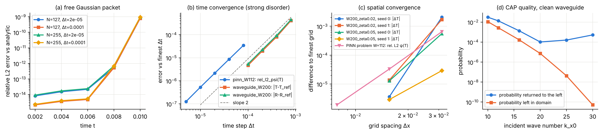
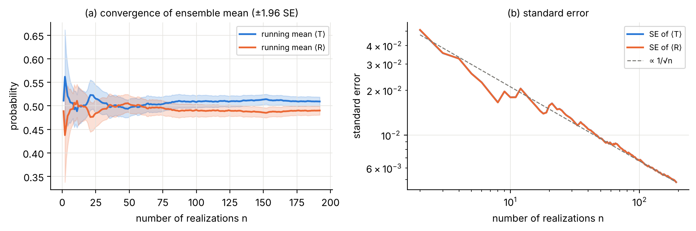

# EK BELGE 1. Çözücü Doğrulamasının Ayrıntıları

*Bu ek belge, “EK BELGE 1. Çözücü Doğrulamasının Ayrıntıları” başlıklı TÜBİTAK 2204-A proje raporunun (Korelasyon Uzunluğunun İki Boyutlu Kuantum Dalga Paketi Taşınımına Etkisinin Sayısal İncelenmesi) ek belgesidir. İçerik, projenin araştırma taslağından (RESEARCH_REPORT_DRAFT_R0_3.md) değiştirilmeden aktarılmıştır; kaynakların tam künyesi ana raporun Kaynaklar bölümündedir. Sayılarda ondalık ayırıcı olarak nokta kullanılmıştır. Hiçbir yeni hesaplama yapılmamıştır.*

Kaynaklar: `results/validation/validation_summary.json`, `v1_eigenmode.csv` … `v7_n_modes.csv`; `validate_solver.py`;
`figures/validation_solver.png`.

**A.1 İç çözücü doğrulaması (tür A)**

| Kontrol | Ayar | Sonuç |
|---|---|---|
| V1 tam özmod (sabit V = 50) | 63², Δt = 10⁻⁴, t ≤ 0.1 | max \|hata\| = 4.58×10⁻¹⁴ (`v1_eigenmode_max_abs_err`) |
| V2 analitik serbest Gauss | 127² ve 255² | bağıl L2 ≤ 9.39×10⁻¹⁰ (`v2_free_gaussian_max_rel_l2`) |
| V6 korunum, kapalı kutu | PINN problemi, W = 112.5 (= E₀), CAP yok | max \|N(t) − 1\| = 1.51×10⁻¹² (`v6.closed_norm_max_dev`) |
| V6 korunum, açık kılavuz | W = 200, t ≤ 1 | max \|N + soğurulan_sol + soğurulan_sağ − N(0)\| = 1.60×10⁻¹³ (`v6.open_bookkeeping_max_dev`) |

V6'nın tanımı `validate_solver.py::v6_conservation` fonksiyonundadır. Değerler `results/validation_log.txt` dosyasında da
kayıtlıdır.

**A.2 Yakınsama ve ayrıklaştırma kontrolleri (tür B)**

| Kontrol | Ayar | Sonuç |
|---|---|---|
| V3 Δt, PINN problemi (W = E₀) | 127², Δt = 1.25×10⁻⁶'ya göre | 2. derece; Δt = 10⁻⁵'te bağıl L2 5.29×10⁻⁷ (`v3`, `pinn_W112`) |
| V3 Δt, dalga kılavuzu (W = 200) | dx = 1/64, t = 1 | 2. derece; Δt = 2×10⁻⁴'te \|ΔT\| = 1.96×10⁻⁵, \|ΔR\| = 2.25×10⁻⁵ (`v3`, `waveguide_W200`) |
| V4 ızgara, dalga kılavuzu (W = 200; ζ = 0.02 ve 0.05) | dx = 1/32, 1/64, 1/128 | dx = 1/64'te \|ΔT\| ≤ 1.4×10⁻⁵; dx = 1/32'de ≤ 2×10⁻³ (README §7; ham T değerleri `v4`) |
| V4 ızgara, PINN problemi | dx = 1/32 … 1/128 | dx = 1/128'de (127²) bağıl L2 1.90×10⁻⁶ (`v4_space_convergence.csv`, `pinn_W112_psi`; değer `T` sütununda) |
| V5 CAP sahte geri dönüşü | temiz kılavuz, k_x0 = 10 … 30 | 20: 1.0×10⁻⁴; 25: 1.6×10⁻⁴; 30: 5.19×10⁻⁴; 16: 1.3×10⁻³; **12: 1.33×10⁻²; 10: 3.07×10⁻²** (`v5_cap_reflection.csv`, `spurious_return`) |
| V7 düzensizlik mod sayısı | W = 100, 24 realizasyon | M = 64: 0.488 ± 0.016; 256: 0.515 ± 0.018; 512: 0.518 ± 0.015; 2048: 0.501 ± 0.014 (`v7_n_modes.csv`) |

**A.3 Bağımsız durağan çapraz doğrulama (tür C)**

| Karşılaştırma | Kapsam | Sonuç |
|---|---|---|
| B2: TDSE paket iletimi ile enerji-ortalamalı bağımsız 1B denklem çözümü | düzensizlik yok; y'den bağımsız yumuşak bariyer, V_b = 150 ve 250 | uzaklık 3.2×10⁻⁴ / 7.0×10⁻⁴; kriter 10⁻³; geçti (`docs/RGF_B2_VALIDATION.md`) |
| B4: TDSE ile durağan RGF, sabit düzensizlik realizasyonunda | ana raporun Bulgular bölümü'deki düzensiz taşınım | **YAPILMADI** |

**README ile küçük fark.** README, CAP geri dönüşünü k_x0 ≥ 20 için "≤ 5×10⁻⁴" olarak verir. CSV'deki en büyük değer k_x0 = 30'da
5.19×10⁻⁴'tür; bu taslak CSV değerini kullanır.

---

### Realizasyon sayısının yeterliliği

**Yeterli örnek sayısı.** W = 100, ζ = 0.05, L_d = 1'de 192 realizasyonla:

- ⟨T⟩ = 0.509 [0.500, 0.519];
- SE, 1/√n ile azalır: n = 48'de 0.010, n = 192'de 0.005;
- 48 realizasyonluk ortalama (0.494) tam ortalamayla 1.5 SE içinde uyumludur.

24–48 realizasyonlu taramalar ⟨T⟩'de ≳ 0.03'lük farkları ayırt edebilir (`results/transport/convergence/summary.csv`;
`figures/realization_convergence.png`; README §9.8).

{width=15cm}

{width=15cm}

