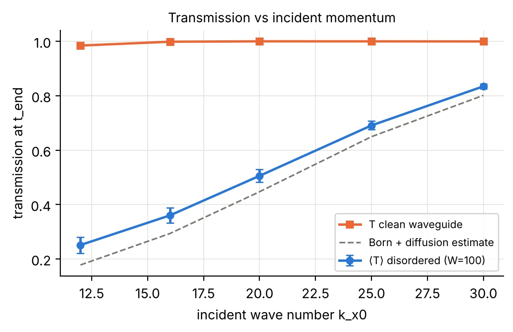
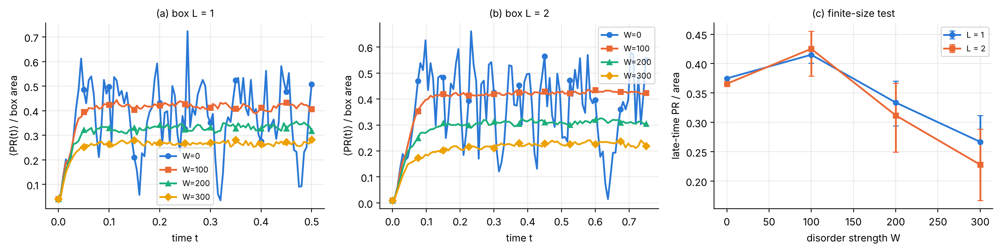
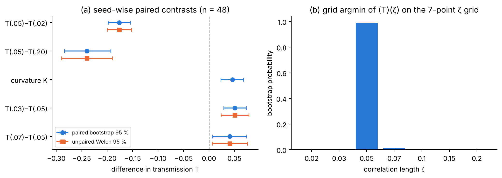
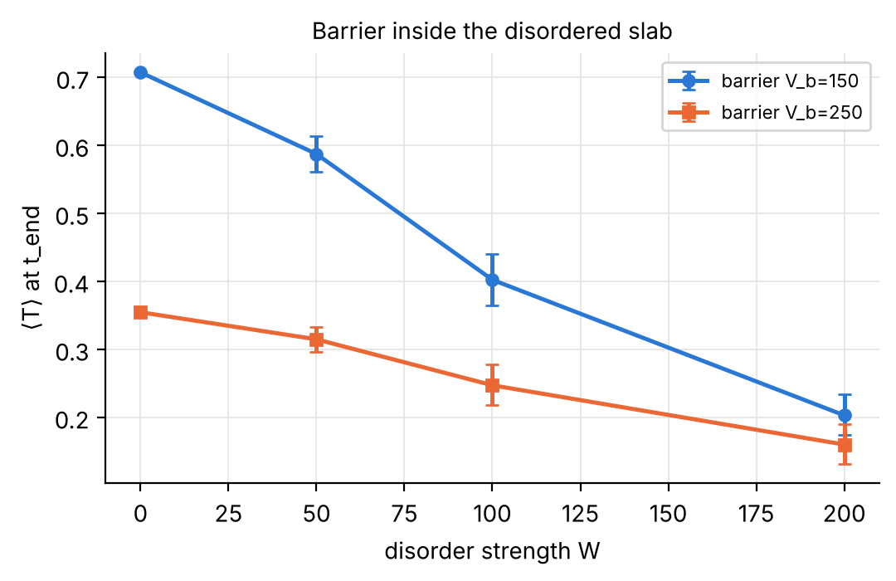
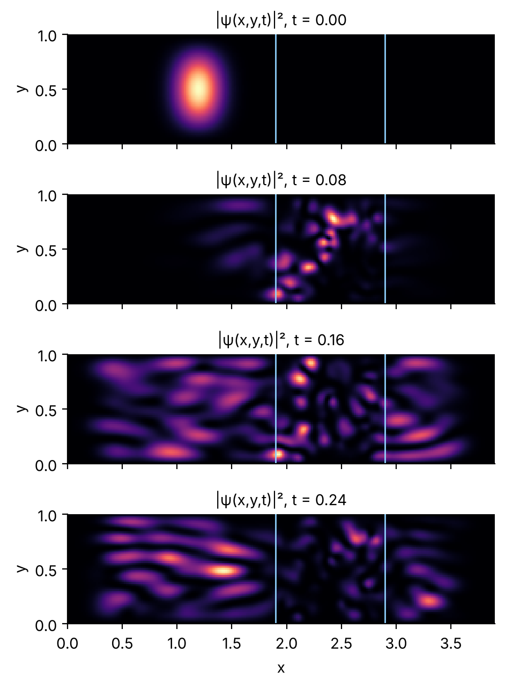

# EK BELGE 2. Ek Taşınım Sonuçları

*Bu ek belge, “EK BELGE 2. Ek Taşınım Sonuçları” başlıklı TÜBİTAK 2204-A proje raporunun (Korelasyon Uzunluğunun İki Boyutlu Kuantum Dalga Paketi Taşınımına Etkisinin Sayısal İncelenmesi) ek belgesidir. İçerik, projenin araştırma taslağından (RESEARCH_REPORT_DRAFT_R0_3.md) değiştirilmeden aktarılmıştır; kaynakların tam künyesi ana raporun Kaynaklar bölümündedir. Sayılarda ondalık ayırıcı olarak nokta kullanılmıştır. Hiçbir yeni hesaplama yapılmamıştır.*

### Düzensizlik gücü taramasının tam tablosu

| W | W/E₀ | kℓ_tr (Born) | ⟨T⟩ [%95 CI] | ⟨R⟩ | sd(T) | P_in(t_end) |
|---|---|---|---|---|---|---|
| 0 | 0 | ∞ | 1.000 | 0.000 | – | 7.9×10⁻⁷ |
| 25 | 0.12 | 167 | 0.938 [0.935, 0.941] | 0.060 | 0.011 | 2.0×10⁻³ |
| 50 | 0.24 | 42 | 0.792 [0.783, 0.801] | 0.207 | 0.032 | 1.1×10⁻³ |
| 75 | 0.37 | 18.5 | 0.629 [0.614, 0.645] | 0.370 | 0.054 | 7.9×10⁻⁴ |
| 100 | 0.49 | 10.4 | 0.494 [0.475, 0.513] | 0.505 | 0.067 | 7.3×10⁻⁴ |
| 150 | 0.73 | 4.6 | 0.316 [0.295, 0.337] | 0.683 | 0.074 | 1.2×10⁻³ |
| 200 | 0.98 | 2.6 | 0.222 [0.202, 0.242] | 0.776 | 0.071 | 1.6×10⁻³ |
| 300 | 1.46 | 1.2 | 0.122 [0.104, 0.141] | 0.875 | 0.066 | 3.2×10⁻³ |

: Tablo EK2.1. Kaynak: `results/transport/strength/summary.csv`; kℓ_tr için `analysis.json["strength"]`.

### Gelen momentum taramasının tam tablosu

| k_x0 | ⟨T⟩ [%95 CI] | ⟨R⟩ | kℓ_tr | temiz kılavuz T / R | t_end |
|---|---|---|---|---|---|
| 12 | 0.251 [0.222, 0.280] | 0.743 | 1.71 | 0.984 / 0.014 | 1.667 |
| 16 | 0.360 [0.333, 0.389] | 0.638 | 4.31 | 0.998 / 0.001 | 1.25 |
| 20 | 0.505 [0.483, 0.529] | 0.494 | 10.4 | 1.000 / 0.000 | 1.0 |
| 25 | 0.691 [0.676, 0.707] | 0.309 | 29.7 | 1.000 / 0.000 | 1.0 |
| 30 | 0.835 [0.826, 0.843] | 0.165 | 77.4 | 0.999 / 0.001 | 1.0 |

: Tablo EK2.2. Kaynak: `results/transport/momentum/summary.csv`; kℓ_tr için `analysis.json["momentum"]`.

{width=11cm}

### Bölge uzunluğu taramasının ham değerleri

| L_d | W = 100: ⟨T⟩ [%95 CI] | W = 200: ⟨T⟩ [%95 CI] |
|---|---|---|
| 0.25 | 0.827 [0.801, 0.852] | 0.602 [0.544, 0.656] |
| 0.5 | 0.694 [0.665, 0.722] | 0.414 [0.368, 0.460] |
| 1 | 0.518 [0.490, 0.548] | 0.249 [0.221, 0.278] |
| 2 | 0.320 [0.302, 0.338] | 0.104 [0.092, 0.116] |
| 3 | 0.232 [0.214, 0.250] | 0.056 [0.050, 0.064] |

: Tablo EK2.3. Kaynak: `results/transport/length/summary.csv`.

### Kapalı kutu şekli

{width=15cm}

### ζ taramasının eşleştirilmiş analizi (post-hoc)

{width=15cm}

### Bariyer ve düzensizlik (tünelleme sorusu)

Ayarlar: genişliği 0.1 olan, bölgenin ortasında yumuşak dikdörtgen bariyer; ζ = 0.05, L_d = 1, n = 24, t_end = 1.5. Bariyer
yüksekliği V_b, boylamasına enerji k_x0²/2 = 200'ün altında (150) veya üstündedir (250).

| V_b | W = 0 | W = 50 | W = 100 | W = 200 |
|---|---|---|---|---|
| 150 | 0.708 | 0.587 [0.561, 0.613] | 0.402 [0.365, 0.440] | 0.203 [0.174, 0.234] |
| 250 | 0.355 | 0.315 [0.296, 0.333] | 0.247 [0.218, 0.277] | 0.160 [0.132, 0.190] |

: Tablo EK2.4. ⟨T⟩ [%95 CI]. Kaynak: `results/transport/barrier/summary.csv`; şekil `figures/transport_barrier.png`.

**Gözlem.** Düzensizlik iletimi yalnızca azaltmıştır. Bu parametrelerde düzensizlik destekli tünelleme gözlenmemiştir. Bu,
iki bariyer yüksekliği ve üç düzensizlik gücüyle sınırlı bir negatif sonuçtur.

{width=11cm}

### İllüstrasyon

{width=8cm}

