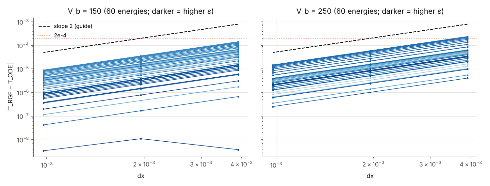
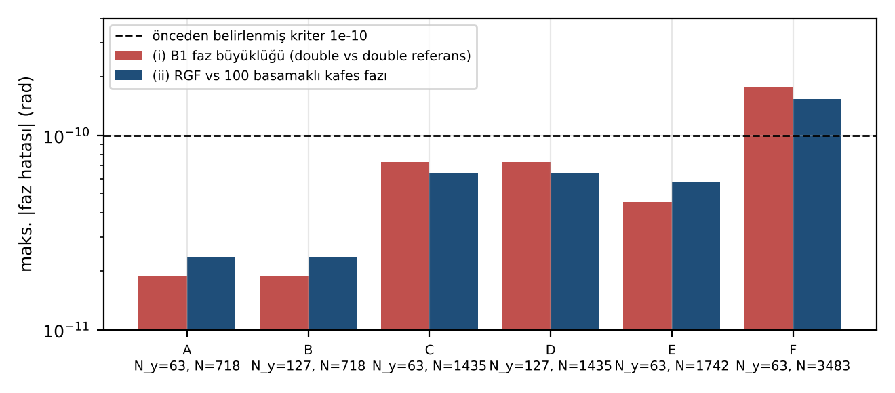
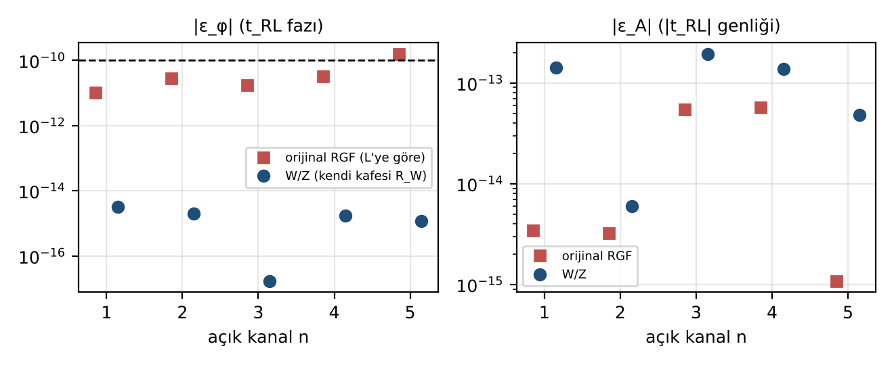
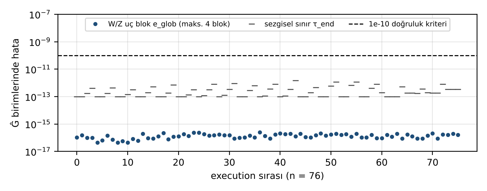

# EK BELGE 4. Bağımsız Durağan Doğrulama Hattı (RGF) ve W/Z Teşhis Çalışmaları

*Bu ek belge, “EK BELGE 4. Bağımsız Durağan Doğrulama Hattı (RGF) ve W/Z Teşhis Çalışmaları” başlıklı TÜBİTAK 2204-A proje raporunun (Korelasyon Uzunluğunun İki Boyutlu Kuantum Dalga Paketi Taşınımına Etkisinin Sayısal İncelenmesi) ek belgesidir. İçerik, projenin araştırma taslağından (RESEARCH_REPORT_DRAFT_R0_3.md) değiştirilmeden aktarılmıştır; kaynakların tam künyesi ana raporun Kaynaklar bölümündedir. Sayılarda ondalık ayırıcı olarak nokta kullanılmıştır. Hiçbir yeni hesaplama yapılmamıştır.*

### Kısa durum

> **Bu bölüm ana fiziksel araştırmadan ayrıdır** ve ana raporun Bulgular bölümü'deki hiçbir sayıyı değiştirmez. Ayrıntılar EK BELGE 4'dedir.

**Neden var?**

- ana rapor, Yöntem: Tablo 3'teki A ve B türü testler çözücünün kendi doğruluğunu ölçer.
- Düzensiz taşınımı **kod paylaşmayan** bağımsız bir yöntemle karşılaştırmak için sabit enerjide çalışan bir yöntem
  seçilmiştir. Bu yöntem, mod uzayında özyinelemeli Green fonksiyonu (RGF) ve Fisher–Lee bağıntısıdır (Datta, 1995; Fisher & Lee, 1981; Lee & Fisher, 1981; MacKinnon, 1985).
- Önceden belirlenmiş B1–B4 ölçütleri tanımlanmıştır (`docs/PHASE2_METHOD_SELECTION.md` §2–§3). Belgenin kuralına göre
  taşınım sonuçları **yalnızca B1–B4'ün hepsi geçerse** bağımsız olarak doğrulanmış sayılır.

| Test | Kısa tanım | Durum |
|---|---|---|
| B1 | temiz kılavuz, 6 konfigürasyon | A–E geçti; **B1-F FAIL** (faz kriteri 10⁻¹⁰, değiştirilmedi) |
| B2 | y'den bağımsız bariyer (düzensizlik yok); RGF ve TDSE, bağımsız 1B denklem çözümüne karşı | **PASS** |
| B3 | sabit düzensizlik realizasyonları; RGF ile seyrek Green referansının karşılaştırması | **FAIL** (dx kriteri) |
| B3X | 6 konfigürasyon; bağımsız dalga fonksiyonu referansı | **FAIL** (dx kriteri) |
| B3Y | başarısız B3X noktalarında ince ızgara, 4 yöntem | **PASS** |
| B4 | sabit düzensizlik realizasyonunda TDSE ile durağan çözümün karşılaştırması | **YAPILMADI** |

: Tablo EK4.1. Ölçülen değerler ve kaynaklar: EK BELGE 4.

**Sonuç.** Bağımsız durağan çapraz doğrulama **tamamlanmamıştır.** Düzensiz taşınım sonuçları durağan bir yöntemle
**henüz bağımsız olarak çapraz doğrulanmamıştır;** bunun için B4 gereklidir.

**RGF sayısal teşhis çalışması (W/Z).**

- B1-F başarısızlığını anlamak için RGF'nin cebirsel olarak eşdeğer bir yeniden yazımı (W/Z) incelenmiştir.
- Bu teşhis çalışmaları **taşınım sonuçlarını doğrulamaz**; yalnızca bir sayısal yöntemin yuvarlama davranışını inceler.

| Konu | Durum |
|---|---|
| W/Z | **NOT VALIDATED** |
| coupled-block deneyi | **DESIGN INSUFFICIENT** (W/Z FAIL anlamına gelmez) |
| ana coupling-scaling deneyi | **NOT RUN** (yalnızca girdi manifestleri üretilmiştir) |
| bağımsız uygulama incelemesi (R0) | **PENDING** |

---

> Buradaki sonuçlar **fiziksel taşınım sonuçlarını doğrulamaz** ve ana raporun Bulgular bölümü'yi değiştirmez.

### B.1 B1–B4 ölçümleri

| Test | Amaç | Durum | Ölçülen | Kaynak |
|---|---|---|---|---|
| B1 | temiz kılavuz, 6 konfigürasyon, 50 enerji; analitik kafes cevabı | A–E geçti; **B1-F FAIL** (faz kriteri 10⁻¹⁰, değiştirilmedi) | F (N_y = 63, dx = 1/1024, L_d = 3, N = 3483): faz büyüklüğü 1.76851694417934×10⁻¹⁰; 100 basamaklı kafes fazına göre 1.5424928001550615×10⁻¹⁰ | `results/rgf_b1_validation/summary.json`, `phase_audit_hp_summary.json`; `docs/RGF_B1_VALIDATION.md` |
| B2 | y'den bağımsız bariyer; RGF ile bağımsız 1B ODE | **PASS** | dx = 1/512'de maks \|ΔT\| = 3.59×10⁻⁵ (V_b = 150), 5.95×10⁻⁵ (V_b = 250); kriter 2×10⁻⁴ | `results/rgf_b2_validation/summary.json`; `docs/RGF_B2_VALIDATION.md` |
| B3 | sabit düzensizlik realizasyonları; seyrek Green referansı | **FAIL: dx_1_512_vs_1_1024** (10 grubun 9'u geçti) | S uyumu ≤ 4.9×10⁻¹²; dx iyileştirmesinde maks \|ΔT₁\| = 5.97×10⁻⁴ > 2×10⁻⁴ (W = 200) | `results/rgf_b3_validation/summary.json`; `docs/RGF_B3_VALIDATION.md` |
| B3X | 6 konfigürasyon; dalga fonksiyonu referansı | **FAIL: C11_dx_refinement** (14 kriterin 13'ü geçti) | S uyumu ≤ 5.3×10⁻¹²; C11: 9.17×10⁻⁴ > 2×10⁻⁴ | `results/rgf_b3x_validation/summary.json`; `docs/RGF_B3X_VALIDATION.md` |
| B3Y | başarısız B3X noktalarında ince ızgara; 4 yöntem | **PASS** | S'de ≤ 9.1×10⁻¹¹ uyum; dx değişimleri dört yöntemde aynı, yani sonlu-fark kafes probleminin özelliği | `results/rgf_b3y_validation/summary.json`; `docs/RGF_B3Y_VALIDATION.md` Part II |
| B4 | sabit düzensizlik realizasyonunda TDSE ile durağan çözüm | **YAPILMADI** | — | `docs/PHASE2_METHOD_SELECTION.md` §3 |

**Kapsam:**

- B1 bir iç tutarlılık testidir.
- B2 kanal bağlaşımını sınamaz.
- B3Y sürekli limite yakınsamayı göstermez ve tek bir realizasyonla sınırlıdır.

### B.2 W/Z teşhis çalışmaları

**W/Z değişkenleri.** RGF'nin küçük büyüklüklü değişkenlerle yazılmış cebirsel bir eşdeğeridir:

$$ \Delta_j = (E\,I - \mathrm{diag}(E_\perp) - V_j)\,dx^2, \qquad W_j = D_j/t + I. $$

| Çalışma | Durum (aynen) | Başlıca ölçüm | Sınırlama | Kaynak |
|---|---|---|---|---|
| B1-F en kötü nokta ayrıştırması | — | 110 basamaklı tam ayrıştırma: hatanın +1.6108×10⁻¹⁰'u (≈ %104) saklanan köşegenin binary64 temsilinden gelir | tek nokta | `experiments/wz_rgf_diagnostic/REPORT.md` §4 |
| Scalar W/Z (tek nokta, 1×1 kanal) | **INCONCLUSIVE** | faz −1.19×10⁻¹⁵ (orijinal +1.5425×10⁻¹⁰); genlik +4.82×10⁻¹⁴ (orijinal −1.08×10⁻¹⁵) | yalnızca kanal 5 | `REPORT.md`; `ERRATUM_worst_point.md` |
| 63 kanallı genlik yuvarlaması | H_A: SUPPORTED (kanal 5'te bağımsız olarak ayırt edilemedi) | W/Z fazı ≤ 3.24×10⁻¹⁵ (orijinal 1.0×10⁻¹¹–1.54×10⁻¹⁰); W/Z genliği maks 1.93×10⁻¹³ (≈ 3.4 kat); \|P\| − 1 = 1.37×10⁻¹⁷ → 4.757×10⁻¹⁴ | temiz cihaz | `amplitude_roundoff_report.md` |
| Coupled-block | **DESIGN INSUFFICIENT** | 76 execution / 72 konfigürasyon; referans ≤ 2.0×10⁻⁶¹ / 3.2×10⁻⁶¹; uç bloklar ≤ 2.5×10⁻¹⁶; 480/480 mutant; eğim 0.78–0.79 < 0.8 | N ≤ 4; **W/Z FAIL değil** | `results_coupled_blocks/coupled_blocks_report.md` |
| Coupling-scaling v2 | manifestler **GENERATED AND FROZEN** (`fac5f5e`); deney **NOT RUN** | XP 60, HO 120 konfigürasyon | "duplicate set" tanımsız (G-1); R0 imzası yok | `PREDICTIONS_coupling_scaling_v2.md`; `R0_REVIEW_PACKET.md` |
| Uygulama düzeyi R0 | **PENDING** | — | `REVIEW_coupling_scaling_v2.md` yok | `R0_REVIEW_PACKET.md` |
| T1–T6 yazılım testleri | PASS (yalnızca yazılım ve protokol) | 54/507/28/468/3528/36 kontrol, 0 başarısız; pytest 691 passed + 2 xfailed | fiziksel doğrulama değildir | `R0_REVIEW_PACKET.md` I.7 (`1668540`) |

**Özet:** W/Z **NOT VALIDATED**; coupled-block **DESIGN INSUFFICIENT**; coupling-scaling **NOT RUN**; R0 **PENDING**.

**Ek şekiller:**

| Şekil | Dosya yolu |
|---|---|
| B1 faz hataları | `docs/turkce_ozet_figurler/sekil1_b1_faz.png` |
| 63 kanal faz/genlik | `docs/turkce_ozet_figurler/sekil2_63kanal.png` |
| coupled-block uç blok hatası | `docs/turkce_ozet_figurler/sekil3_coupled.png` |
| B2 hata ve yakınsama | `results/rgf_b2_validation/{error_vs_dx,error_vs_energy,order_vs_energy}.png` |

---

{width=13cm}

{width=13cm}

{width=13cm}

{width=13cm}

