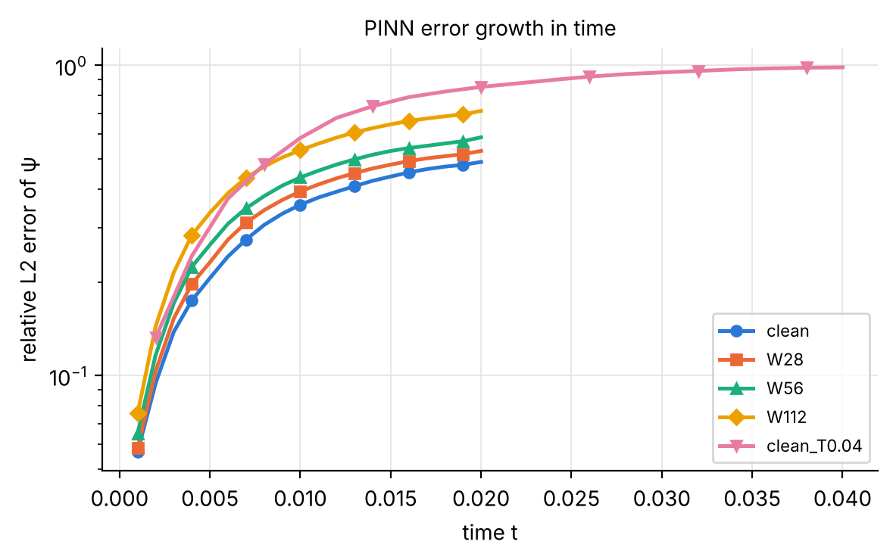
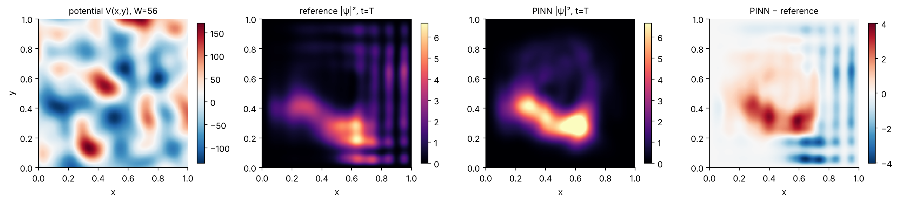

# EK BELGE 3. PINN Ayrıntıları

*Bu ek belge, “EK BELGE 3. PINN Ayrıntıları” başlıklı TÜBİTAK 2204-A proje raporunun (Korelasyon Uzunluğunun İki Boyutlu Kuantum Dalga Paketi Taşınımına Etkisinin Sayısal İncelenmesi) ek belgesidir. İçerik, projenin araştırma taslağından (RESEARCH_REPORT_DRAFT_R0_3.md) değiştirilmeden aktarılmıştır; kaynakların tam künyesi ana raporun Kaynaklar bölümündedir. Sayılarda ondalık ayırıcı olarak nokta kullanılmıştır. Hiçbir yeni hesaplama yapılmamıştır.*

### PINN değerlendirmesi (araştırma taslağından tam metin)

### 8.1 Ne yapıldı?

- **Problem.** PINN, 1 × 1 kapalı kutuda kısa bir zaman penceresinde (t ≤ 0.02) bir Gauss paketinin yayılımını çözmüştür.
- **Karşılaştırma.** Her PINN çözümü, **aynı potansiyelle** çalışan klasik çözücünün sonucuyla karşılaştırılmıştır. Klasik
  çözücünün bu problemdeki ayrıklaştırma hatası ≈ 10⁻⁶'dır (V3, V4; EK BELGE 1).
- **Koşular.** 18 çalışma koşusu ve 3 teşhis koşusu vardır; donanım yalnızca CPU'dur.
- **Kapsam.** PINN, ana taşınım deneylerinin dalga kılavuzu geometrisinde **çalıştırılmamıştır.** Bu nedenle PINN sonuçları
  ana soruya doğrudan katkı sağlamaz; yöntemsel bir değerlendirmedir.

### 8.2 Klasik çözücüyle karşılaştırma

| Yapılandırma | bağıl L2 hatası ψ(T) | maks \|norm − 1\| |
|---|---|---|
| temiz, 3 ağ tohumu | 0.489, 0.487, 0.567 (ort. 0.514) | ≤ 0.061 |
| W = 28 (E₀/4) | 0.530 | 0.038 |
| W = 56 (E₀/2), 3 ağ tohumu | 0.586, 0.574, 0.610 (ort. 0.590) | ≤ 0.072 |
| W = 112 (E₀) | 0.713 | 0.053 |
| W = 56, ζ = 0.04 / 0.08 / 0.16 | 0.685 / 0.586 / 0.497 | ≤ 0.04 |
| Fourier özniteliği olmadan, temiz | **1.152** | 0.047 |
| zaman penceresi T = 0.01 / 0.02 / 0.04 (temiz) | **0.184** / 0.489 / **0.986** | 0.009 / 0.023 / 0.123 |
| 3 kat eğitim bütçesi (temiz) | 0.281 | 0.007 |

: Tablo EK3.1. Bağıl L2 hatası, PINN çözümünün klasik çözümden farkının normunun klasik çözümün normuna oranıdır; 1 hata,
ψ = 0 tahmininin hatasıyla aynı büyüklüktedir. Kaynak: `results/pinn/summary.csv` (`rel_l2_final`, `norm_max_dev`). Tam
tablo EK BELGE 3'dedir.

**Sonuçlar:**

- **Doğruluk.** PINN bu bütçede taşınım fiziği için **yeterince doğru değildir.** En kolay ayarda bile hata ≈ %49'dur.
- **Maliyet.** Klasik çözücü 0.7–2.9 s sürerken PINN eğitimi aynı CPU'da 470–3100 s sürmüştür (`reference_time_s`,
  `train_time_s`).
- **Genel değerlendirme.** Bu ileri problem için PINN'in klasik çözücüye göre **bir üstünlüğü bulunmamıştır.**

### 8.3 Gözlenen başarısızlık modları

1. **Zaman penceresi.** Hata pencere uzadıkça büyür: T = 0.01'de %18, T = 0.04'te %99. PINN, paket duvarlara ulaşınca
   oluşan girişim saçaklarını yakalayamaz (README §9.10).
2. **Düzensizlik.**
   - Hata W ile artar: 0.53 → 0.59 → 0.71. W = 28 ve W = 112 tek tohumludur; W = 56 için değer üç tohumun ortalamasıdır.
   - ζ küçüldükçe de artar: 0.50 → 0.59 → 0.69. Bu tarama tek tohumludur.
   - **Temiz ile W = 56 karşılaştırması.** Ortalama hatalar 0.514 ve 0.590'dır. Karşılaştırma **grup başına yalnızca üç ağ
     tohumuna** dayanır.
     - Welch t testi (Welch, 1947): t = 2.70, p = 0.086.
     - Fark %5 düzeyinde **istatistiksel olarak anlamlı değildir**.
     - Örneklem çok küçüktür. Sonuç keşifseldir ve yalnızca olası bir eğilim olarak okunmalıdır.
3. **Spektral yanlılık.** Sinir ağları düşük frekansları daha kolay öğrenir (Rahaman vd., 2019). Fourier öznitelikleri olmadan hata
   1.15'tir.
4. **Kolokasyon noktalarına aşırı uyum.** Sabit eğitim noktalarıyla düşük eğitim kaybına rağmen hata 1.22 olmuştur
   (EK BELGE 3).
5. **Kısmi iyileşmeler.**
   - 3 kat bütçe hatayı 0.49'dan 0.28'e düşürmüştür.
   - Kalıntı-uyarlamalı örnekleme (RAD) ılımlı bir iyileşme vermiştir; bu sonuç tek tohumludur (Wu vd., 2023).

Bu modlar literatürde bildirilen PINN güçlükleriyle niteliksel olarak benzerdir (Krishnapriyan vd., 2021; Shah vd., 2022; Wang, Teng vd., 2021; Wang, Wang vd., 2021). Bu benzerliğin nedeni bu
çalışmada sınanmamıştır.

### 8.4 Sınırlar

- Yalnızca CPU bütçesi, tek bir mimari ve yapılandırma başına en fazla 3 ağ tohumu kullanılmıştır.
- Sonuç PyTorch iş parçacığı sayısına bağlıdır (EK BELGE 3).
- Daha büyük ağlar, daha uzun eğitim, GPU, zaman adımlı eğitim ve dalga kılavuzu geometrisi denenmemiştir.
- Sonuçlar **yalnızca bu bütçe ve bu standart teknikler** içindir; PINN'ler hakkında genel bir hüküm değildir.

---

### Eğitim ayrıntıları ve teşhis koşuları

**Tam sonuç tablosu.**

| Yapılandırma | koşu(lar) | bağıl L2 ψ(T) | bağıl L2 \|ψ\|²(T) | maks \|norm − 1\| |
|---|---|---|---|---|
| temiz, 3 tohum | `clean_fourier_uniform_s{0,1,2}` | 0.489, 0.487, 0.567 | 0.57–0.76 | ≤ 0.061 |
| W = 28 | `W28_fourier_uniform_s0` | 0.530 | 0.607 | 0.038 |
| W = 56, 3 tohum | `W56_fourier_uniform_s{0,1,2}` | 0.586, 0.574, 0.610 | 0.67–0.75 | ≤ 0.072 |
| W = 56, farklı düzensizlik realizasyonu | `W56_d1_fourier_uniform_s0` | 0.582 | 0.760 | 0.038 |
| W = 112 | `W112_fourier_uniform_s0` | 0.713 | 0.957 | 0.053 |
| W = 56, ζ = 0.04 / 0.08 / 0.16 | `W56_zeta0.04…`, `W56_fourier_uniform_s0`, `W56_zeta0.16…` | 0.685 / 0.586 / 0.497 | 0.90 / 0.69 / 0.58 | ≤ 0.04 |
| Fourier yok: temiz / W = 56 | `*_nofourier_uniform_s0` | 1.152 / 0.724 | 1.42 / 0.78 | ≤ 0.05 |
| RAD örnekleme: temiz / W = 56 | `*_fourier_rad_s0` | 0.469 / 0.525 | 0.45 / 0.56 | ≤ 0.025 |
| T = 0.01 / 0.02 / 0.04 | `clean_T0.01…`, `clean_fourier_uniform_s0`, `clean_T0.04…` | 0.184 / 0.489 / 0.986 | 0.15 / 0.57 / 1.02 | 0.009 / 0.023 / 0.123 |
| 3 kat bütçe | `clean_long_fourier_uniform_s0` | 0.281 | 0.322 | 0.007 |

Kaynak: `results/pinn/summary.csv`.

**Ağ ve kısıt ayrıntıları** (`model.py`, `pinn_core.py`, `train.py`):

- Girdiler [0, 1]'e normalize edilir: x/L_x, y/L_y, t/T.
- Fourier öznitelikleri: birim başına 1–6 çevrim aralığında 6 frekans.
- Sert kısıtlar: u = u₀ + A·B·τ·N_u ve v = v₀ + A·B·τ·N_v; burada B = 16x̂(1−x̂)ŷ(1−ŷ) ve τ = t/T.
- Kayıp: ölçeklenmiş kalıntının (T/A)·(f_u, f_v) ortalama karesi, artı normalizasyon cezası (∫|ψ|² − 1)².

**Optimizasyon:**

- Adam (Kingma & Ba, 2015): öğrenme oranı 10⁻³, her 1000 adımda yarıya iner; PDE ağırlığı 300 adımda ısıtılır; gradyan kırpma uygulanır.
- Ardından sabit 16000 noktada L-BFGS (Liu & Nocedal, 1989).

**Teşhis koşuları:**

- **Sabit kolokasyon ile L-BFGS.** Son eğitim kaybı 9.07×10⁻⁴'tür (`diag_fixed_points_lbfgs/train_info.json`,
  `final_loss`). Buna karşın çözüm hatası 1.218'dir (`eval_summary.json`). Bu aşırı uyumdur. Bu koşu için ayrılmış noktalarda
  (*held-out*) bir kalıntı değeri saklanmamıştır.
- **Her adımda taze örnek.** Eğitim ve ayrılmış nokta kalıntıları 5.67×10⁻³ ve 9.28×10⁻³'tür
  (`diag_stochastic/train_info.json`, `final_train_pde`, `holdout_pde`). Çalışma koşularında bu protokol kullanılmıştır.
- **Nedensel ağırlıklandırma** (ε = 1) (Wang vd., 2024). Son hata 0.565'tir; ağırlıklandırma olmadan 0.4885'tir (`diag_stochastic_causal`,
  `diag_stochastic`).

**İş parçacığı bağımlılığı.** 2 iş parçacığıyla ağırlıklar bit düzeyinde yeniden üretilmiştir. 4 iş parçacığıyla son hata
0.48850'den 0.48987'ye değişmiştir (`docs/REPRODUCIBILITY_AUDIT.md` §5).

---

### Tek bir çözümün 3B yüzey gösterimi

Aşağıdaki üç görsel ayrı bir PINN test problemine aittir (1 × 1 kapalı kutu, W = 56.25, ζ = 0.08, düzensizlik tohumu 0, T = 0.02, 127 × 127 saklı ızgara). Fiziksel model iki boyutludur; 3B yüzeyler 2B alanların gösterimidir, üç boyutlu fiziksel simülasyon değildir. Tek bir realizasyon ve tek bir ağ tohumu gösterilmektedir; ansambl ortalaması değildir. t = T'de bağıl L2 hatası ψ için 0.5864, |ψ|² için 0.6932'dir; bu iki değer karıştırılmamalıdır. Köken ayrıntıları: docs/tubitak_visualization_notes.md.

![Şekil EK3.1. PINN ve DST referans dalga fonksiyonu karşılaştırması. Aynı düzensizlik realizasyonunda (W = 56,25, ζ = 0,08, tohum 0) t = T = 0,02 anındaki olasılık yoğunluğu \|ψ(x, y)\|². Sol panel referans çözümdür (DST tabanlı split-step çözücü); sağ panel PINN tahminidir. İki panelde ızgara, z aralığı, renk ölçeği ve kamera açısı aynıdır. Farklar gizlenmemiştir: PINN'in tepe değeri 9,31, referansın tepe değeri 6,66'dır ve yoğunluğun uzaysal dağılımı belirgin biçimde farklıdır. Son anda bağıl L2 hatası ψ için 0,586, \|ψ\|² için 0,693'tür. Bu görsel, iki boyutlu bir sayısal alanın 3B yüzey gösterimidir; düşey eksen |ψ|² değerini gösterir. Üç boyutlu bir fiziksel sistemin simülasyonu değildir. Bu tek bir realizasyon ve tek bir ağ tohumudur; ansambl ortalaması veya temsili bir PINN performansı değildir. PINN bu çalışmada ikincil bir yöntemsel karşılaştırmadır. Veri: `results/pinn/W56_fourier_uniform_s0/eval_fields.npz`, `eval_summary.json`.](../TUBITAK_SUPPLEMENTARY_MATERIAL_R0/figures/fig2_pinn_dst_karsilastirma_3b.png){width=15cm}

![Şekil EK3.2. PINN tahmininin DST referansından mutlak farkı. Şekil EK3.1'deki iki yoğunluk arasındaki **mutlak** fark \| \|ψ_PINN\|² − \|ψ_DST\|² \|, t = T = 0,02 (işaretli fark değildir; işaret bilgisi bu gösterimde yoktur). DST çözümü referans alınmıştır. En büyük mutlak fark 4,02'dir. Kaynak veride saklanan bağıl L2 hatası, son anda ψ için 0,586, ρ = \|ψ\|² için 0,693'tür. Bu görsel, iki boyutlu bir sayısal alanın 3B yüzey gösterimidir; düşey eksen mutlak farkı gösterir. Üç boyutlu bir fiziksel sistemin simülasyonu değildir. Tek bir düzensizlik realizasyonu (W = 56,25, ζ = 0,08, tohum 0) ve tek bir ağ tohumu gösterilmektedir; ansambl ortalaması değildir. Veri: `results/pinn/W56_fourier_uniform_s0/eval_fields.npz`, `eval_summary.json`.](../TUBITAK_SUPPLEMENTARY_MATERIAL_R0/figures/fig3_pinn_dst_mutlak_fark_3b.png){width=11cm}

![Şekil EK3.3. İki boyutlu düzensizlik potansiyelinin 3B yüzey gösterimi. PINN test probleminde kullanılan Gauss-korelasyonlu rastgele potansiyel V(x, y) (W = 56,25, ζ = 0,08, düzensizlik tohumu 0; 1 × 1 kapalı kutu, 127 × 127 ızgara, boyutsuz birimler). Bu görsel, iki boyutlu bir sayısal alanın 3B yüzey gösterimidir; düşey eksen yalnızca V'nin değerini gösterir, üçüncü bir uzay boyutu değildir. Üç boyutlu bir fiziksel sistemin simülasyonu değildir. Gösterilen, tek bir düzensizlik realizasyonudur; ansambl ortalaması değildir. Bu potansiyel, ana taşınım deneylerinin dalga kılavuzu geometrisine ait değildir. Veri: `results/pinn/W56_fourier_uniform_s0/eval_fields.npz` (`V`).](../TUBITAK_SUPPLEMENTARY_MATERIAL_R0/figures/fig1_duzensizlik_potansiyeli_3b.png){width=11cm}

{width=11cm}

{width=15cm}

Etkileşimli, beyaz arka planlı animasyon (visualizations/tubitak/wavefunction_animation_white.html) sergi standı için hazırlanmıştır ve raporun parçası değildir.
