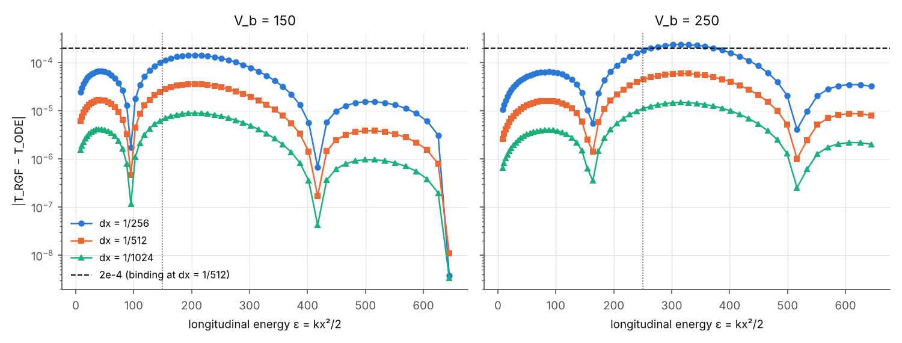
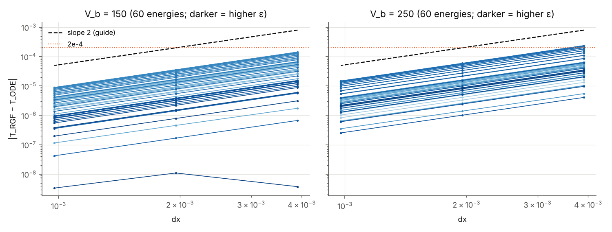
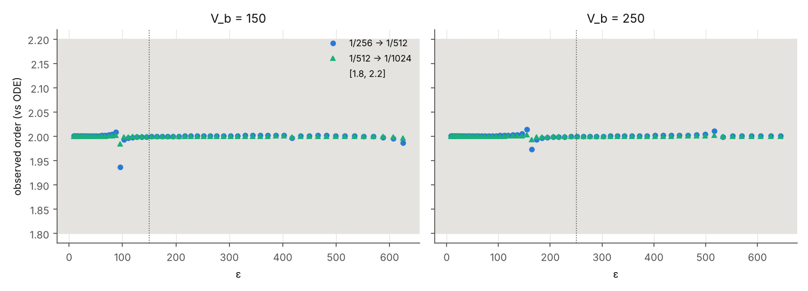

# Benchmark B2: stationary RGF vs the independent 1D ODE (smooth barrier, uniform in y)

Phase 2, benchmark B2 of [PHASE2_METHOD_SELECTION.md](PHASE2_METHOD_SELECTION.md)
§3. Date: 2026-11-06.

* Code commit: `bc8f144` (`validate_rgf_b2.py`, `tests/test_rgf_b2.py`, and an
  additive `rgf_b2` code-fingerprint kind in `provenance.py`).
* Artifacts: `results/rgf_b2_validation/`, generated from that commit with a
  clean working tree.
* Solvers used unchanged: `stationary.py`, `smatrix_spec.py`, `ode1d.py`.
* Thresholds: unchanged. Energies: not selected or tuned.

**Outcome in one line.** Every binding B2 criterion passes for both barrier
heights:
* RGF vs ODE at dx = 1/512: max |ΔT| = 3.59×10⁻⁵ (V_b = 150) and
  5.95×10⁻⁵ (V_b = 250), against 2×10⁻⁴;
* channel mixing, unitarity and reciprocity, each with orders of magnitude
  of margin;
* all four ODE-reference checks;
* the separate TD vs energy-averaged ODE comparison: distance 3.2×10⁻⁴ and
  7.0×10⁻⁴, against 1×10⁻³.

The measured convergence order is 2.000 (median) at every resolvable energy.

**What this does and does not establish.**
* B2 tests the RGF with a **non-zero potential** against a method that
  shares no code with it. It tests only a y-uniform potential, so the
  channels decouple. Inter-channel coupling by a y-dependent potential is
  the subject of B3. The comparison with the TD solver at fixed disorder
  realizations is B4.
* B1 still does not fully pass: its provisional phase criterion fails on the
  longest device ([RGF_B1_VALIDATION.md](RGF_B1_VALIDATION.md)).
* Phase 2 transport results are independently validated only when B1–B4 all
  pass (spec §3). That is **not** the case yet.

Reproduce:
```bash
python validate_rgf_b2.py                 # ~13 min on 4 CPU cores (RGF ~11 min, TD part ~3 min)
python -m pytest -q tests/test_rgf_b2.py  # ~1 min with the committed artifacts
```
The script sets `OPENBLAS_NUM_THREADS=1` if unset (performance only;
`stationary.py` docstring). Options: `--no-td`, `--no-plots`, `--out DIR`.

---

## 1. What is compared

### 1.1 Same potential
Both sides use `Potential(cfg).barrier_numpy` with
`cfg = waveguide_config(barrier_height=V_b)`:
* V_b ∈ {150, 250}, width 0.1, edge width e = 0.01, centre 2.4, no
  disorder;
* V_b(x) = V_b·½[tanh((x − x₁)/e) − tanh((x − x₂)/e)], x₁,₂ = 2.35, 2.45.

No new barrier formula is introduced. How each side evaluates it:
* **RGF.** `build_device` calls the callable on the slice × quadrature grid.
  The driver wraps `barrier_numpy` in a recorder, so the exact array the RGF
  sampled is kept. For all 8 devices (2 V_b × 3 dx, plus the 2 wide
  buffer-check devices), every quadrature column of that array is
  **bitwise identical** to `barrier_numpy(x_j)` at the slice positions
  (`summary.json → potential_checks`; test
  `test_rgf_samples_are_the_potential_barrier_callable_bitwise`). A
  perturbation of 10⁻¹⁵ is detected (`test_recording_wrapper_detects_a_different_potential`).
* **ODE.** It evaluates `ode1d.potential_barrier_callable(cfg)`, a separate
  `Potential` instance with the same parameters, at its own adaptive
  integration points. Its scalar values equal the array values bitwise at
  the RGF slices.
* **Nothing else is shared.** No intermediate result passes between the two
  calculations.

### 1.2 y-uniform potential, channel decoupling
With V(x, y) = V_b(x), the DST-I quadrature gives V_j = V_b(x_j)·I in exact
arithmetic (spec §2.7.1). Measured in floating point (N_q = 127 ≥ 2N_y):
* largest off-diagonal block entry: 4.3×10⁻¹³ (V_b = 150) and 7.1×10⁻¹³
  (V_b = 250), i.e. ≈ 3×10⁻¹⁵ relative to V_b;
* diagonal minus V_b(x_j): ≤ 4.5×10⁻¹³.

Channel decoupling is therefore **measured, not assumed**. The resulting
mixing probabilities are below 10⁻³⁰ (§3.3).

### 1.3 Energy convention
The ODE solves −½φ″ + V_b(x)φ = εφ. The RGF works at the total waveguide
energy

  E = ε + E₁^⊥,  E₁^⊥ = π²/(2L_y²) = π²/2,

using the same double `transverse_basis(1, 63).E_perp[0]` that the RGF uses.
So T_RGF(E = ε + E₁^⊥) is compared with T_ODE(ε). It is never compared at
equal E (test `test_total_energy_conversion`; every CSV row satisfies
`E_total == epsilon + π²/2` exactly).

Compared quantities: probabilities only.
* T_RGF = Σₘ |(t_RL)_{m1}|² over all open outgoing channels.
* R_RGF = Σₘ |(r_L)_{m1}|².
* T_ODE = |t|², R_ODE = |r|².

These do not depend on the reference planes. The planes are recorded:
* RGF: convention P, the first and last device slices x = 1.5 and 3.5
  (spec §2.7.5).
* ODE: incident and reflected waves at x_left, transmitted at x_right of its
  clean interval [2.18, 2.62].

The complex amplitudes are therefore **not** compared. They differ by known
plane phases.

### 1.4 Energies and thresholds
The grid is kx = linspace(4.09, 35.91, 60), ε = kx²/2, E = ε + π²/2. That is
1 open channel at the bottom and 11 at the top, with 10 transverse
thresholds inside the range.

Threshold rule (spec B1/B4): if |E − Eₙ^⊥| < 10⁻³E, E is moved to
Eₙ^⊥(1 ± 2×10⁻³) on its own side, and the adjusted ε is used by both
solvers.
* No point qualifies. The closest is kx = 12.18 (E = 79.11, n = 4), at
  1.92×10⁻³E. The next is kx = 15.42 (n = 5), at 3.1×10⁻³E.
* So **all 60 original energies are used unchanged**, none is dropped, and
  `energy_grid.csv` records for each point:
  * kx and ε;
  * the nearest threshold and its distance;
  * the number of open channels;
  * the adjusted flag.
* The rule is deterministic and tested on synthetic near-threshold points
  (`test_threshold_rule_deterministic_and_grid_preserved`).

*Grid note.* `validate_ode1d.py` (the earlier ODE validation) used 60 points
uniform in ε over the same range. B2 uses points uniform in kx, as
specified for this task. The ODE-reference criteria are therefore
**re-evaluated on the B2 energies** here (§3.4), rather than inherited.

### 1.5 Discretization
| | |
|---|---|
| RGF device | x ∈ [1.5, 3.5] (barrier at 2.35–2.45; ≥ 0.85 clean buffer on each side), slices x_j = 1.5 + (j−1)dx |
| dx | 1/256, 1/512 (binding), 1/1024 → N = 513, 1025, 2049 slices |
| transverse | N_y = 63 modes (all kept, open and closed), N_q = 127 quadrature points |
| leads | clean (V = 0); |V| on the first lead slices is 0.0 in double precision (tanh tail ≈ V_b e^{−170}) |
| buffer check | same at dx = 1/512 on x ∈ [1.0, 4.0]: max change of T = 2.0×10⁻¹³ |
| ODE | `ode1d.solve_scattering`, DOP853, rtol = atol = 10⁻¹², interval from `clean_interval(tol = 10⁻¹²)` = [2.18, 2.62], 1250–1454 evaluations |

The RGF uses the finite-difference lattice dispersion and the ODE the
continuum. **No correction is applied** to the RGF energy or wave number.
The lattice-dispersion error is what the dx study measures.

---

## 2. Acceptance criteria (spec §3 B2, unchanged)

| ID | Criterion | Status in spec |
|---|---|---|
| A | max over 60 energies of \|T_RGF − T_ODE\| ≤ 2×10⁻⁴ at dx = 1/512, both V_b | kept, **binding** |
| B | convergence order measured from dx = 1/256, 1/512, 1/1024 for every energy; Richardson only if the order is in [1.8, 2.2]; Richardson \|ΔT\| ≤ 2×10⁻⁵ | measured; Richardson criterion **provisional** |
| C | off-diagonal T^{L→R}_{m≠1←1} ≤ 10⁻¹² (checked for both incidence directions) | kept |
| D | U = max(\|S†S − I\|, \|SS† − I\|) ≤ 10⁻¹⁰, full S | kept |
| E | Q = max\|S − Sᵀ\| ≤ 10⁻⁸, full S (both incidence directions) | new (pre-solver) |
| F | ODE reference: sharp barrier vs closed form ≤ 10⁻⁸; flux ≤ 10⁻⁹; rtol 10⁻¹⁰→10⁻¹² change ≤ 10⁻⁹; clean range doubled ≤ 10⁻¹⁰ | new (pre-solver), [ODE1D_VALIDATION.md](ODE1D_VALIDATION.md) |
| TD | TD vs energy-averaged ODE (B4 protocol): P_in(t_end) ≤ 10⁻⁴, dist(⟨T⟩, [T_TD, T_TD + P_in]) ≤ 10⁻³, same for R; quadrature halving ≤ 2×10⁻⁴ | kept |

All the values below come from `summary.json`, `td_energy_average.json` and
the CSV files.

---

## 3. Results (RGF vs ODE)

### 3.1 Transmission error at each dx

| V_b | dx | N | max \|ΔT\| | RMS \|ΔT\| | at ε (kx) | max below (ε < 0.9V_b) | near (0.9–1.1 V_b) | above (ε > 1.1V_b) |
|---|---|---|---|---|---|---|---|---|
| 150 | 1/256 | 513 | 1.437×10⁻⁴ | 7.06×10⁻⁵ | 205.4 (20.27) | 6.8×10⁻⁵ | 1.2×10⁻⁴ | 1.44×10⁻⁴ |
| 150 | **1/512** | 1025 | **3.591×10⁻⁵** | 1.76×10⁻⁵ | 205.4 (20.27) | 1.7×10⁻⁵ | 3.1×10⁻⁵ | 3.59×10⁻⁵ |
| 150 | 1/1024 | 2049 | 8.98×10⁻⁶ | 4.41×10⁻⁶ | 205.4 (20.27) | 4.3×10⁻⁶ | 7.7×10⁻⁶ | 8.98×10⁻⁶ |
| 250 | 1/256 | 513 | 2.382×10⁻⁴ | 1.09×10⁻⁴ | 315.6 (25.12) | 1.1×10⁻⁴ | 2.0×10⁻⁴ | 2.38×10⁻⁴ |
| 250 | **1/512** | 1025 | **5.951×10⁻⁵** | 2.71×10⁻⁵ | 315.6 (25.12) | 2.8×10⁻⁵ | 5.0×10⁻⁵ | 5.95×10⁻⁵ |
| 250 | 1/1024 | 2049 | 1.49×10⁻⁵ | 6.78×10⁻⁶ | 315.6 (25.12) | 7.0×10⁻⁶ | 1.2×10⁻⁵ | 1.49×10⁻⁵ |

Regime counts (of 60): 23 below, 4 near and 33 above for V_b = 150; 32
below, 4 near and 24 above for V_b = 250.

**Criterion A passes**, with a margin of 5.6× (V_b = 150) and 3.4×
(V_b = 250). Notes:
* The coarse grid dx = 1/256 would exceed 2×10⁻⁴ for V_b = 250 (2.38×10⁻⁴,
  around ε ≈ 280–370). It is not the binding grid.
* Relative errors |ΔT|/T_ODE at dx = 1/512 are ≤ 2.1×10⁻⁴ (V_b = 150) and
  ≤ 4.3×10⁻⁴ (V_b = 250). The smallest transmissions are T = 0.029 and
  0.0061 at ε = 8.4.



**Dependence on ε and V_b** (all 60 energies; observations, not a model):
* The error varies smoothly with ε at every dx, changes sign twice in ε
  (|ΔT| dips near ε ≈ 95 and 420 for V_b = 150, and near 165 and 515 for
  V_b = 250), and keeps the same shape at every dx.
* It is **not** concentrated at ε ≈ V_b. The largest errors lie above the
  barrier, at ε ≈ 1.3–1.4 V_b, where T(ε) rises steeply (T_ODE = 0.75 and
  0.64 there).
* The error is larger for the higher barrier.
* Across energies, the error correlates with ε²·dT/dε (r = −0.92 and
  −0.88), which is consistent with a dispersion-type error ∝ dx². This was
  not modelled quantitatively.
* At the top of the V_b = 150 range, T_ODE = 1 − 1.5×10⁻⁸ (near a
  transmission resonance), and the error falls to ≈ 10⁻⁸ (§3.2).

### 3.2 Convergence order (measured, every energy)
Per energy, p = log₂(|e(dx)| / |e(dx/2)|) with e = T_RGF − T_ODE (signed),
from consecutive pairs. A "self" order uses only RGF values,
log₂(|T₂₅₆ − T₅₁₂| / |T₅₁₂ − T₁₀₂₄|), and is independent of the ODE. An
order is marked unresolvable (NaN) when an error is below 10⁻⁸, i.e. 10× the
ODE reference accuracy.

| V_b | pair | n | min | Q1 | median | Q3 | max |
|---|---|---|---|---|---|---|---|
| 150 | 1/256→1/512 | 59 | 1.937 | 2.0001 | 2.0010 | 2.0016 | 2.009 |
| 150 | 1/512→1/1024 | 59 | 1.985 | 2.0000 | 2.0003 | 2.0004 | 2.002 |
| 150 | self (3 grids) | 60 | −0.076 | 1.9999 | 2.0012 | 2.0020 | 2.011 |
| 250 | 1/256→1/512 | 60 | 1.973 | 2.0007 | 2.0011 | 2.0017 | 2.014 |
| 250 | 1/512→1/1024 | 60 | 1.993 | 2.0002 | 2.0003 | 2.0004 | 2.004 |
| 250 | self (3 grids) | 60 | 1.966 | 2.0009 | 2.0014 | 2.0021 | 2.018 |

* The orders computed from the maximum errors are 2.0005 and 2.0001
  (V_b = 150), and 2.0007 and 2.0002 (V_b = 250).
* In no case does the error change sign between dx = 1/512 and 1/1024.
* **One energy is unresolvable:** V_b = 150, kx = 35.91 (ε = 644.8). T_ODE
  is 1 − 1.5×10⁻⁸ there, and the errors are 3.7×10⁻⁹, 1.1×10⁻⁸ and
  3.4×10⁻⁹. These are at the ODE accuracy level and not monotone in dx. Its
  ODE-based orders are NaN and its self order is −0.08. It is reported, not
  removed. The binding criterion A is evaluated at that energy as at every
  other, and the error there is 1.1×10⁻⁸.

Contrary to the toy sharp-barrier study (spec §2.7.10), the smooth barrier
is in the asymptotic second-order regime already at dx = 1/256. The tanh
edge (e = 0.01 ≈ 5dx at 1/512) is resolved well enough.

**Richardson (provisional).** It is applied per energy only where both
ODE-based orders lie in [1.8, 2.2]: 59 of 60 energies for V_b = 150 (all but
the unresolvable one) and 60 of 60 for V_b = 250. It uses
T_R = T₁₀₂₄ + (T₁₀₂₄ − T₅₁₂)/3. Max |T_R − T_ODE| is 1.9×10⁻⁹ and 4.2×10⁻⁹,
against the provisional 2×10⁻⁵. The extrapolated RGF agrees with the ODE to
the 10⁻⁹ level. That is a strong, independent consistency check of the
lattice formulation (lead self-energies, Fisher–Lee normalization with
discrete velocities).




### 3.3 Unitarity, reciprocity, channel mixing, conditioning
Maximum over all 60 energies, both incidence directions and the full S
(2N_open × 2N_open, up to 22 × 22):

| V_b | dx | U (≤ 10⁻¹⁰) | Q (≤ 10⁻⁸) | mixing ch. 1 (≤ 10⁻¹²) | mixing, all channels | \|T₁+R₁−1\| | min rcond(D_j) |
|---|---|---|---|---|---|---|---|
| 150 | 1/256 | 9.4×10⁻¹⁴ | 3.7×10⁻¹⁵ | 4.8×10⁻³³ | 1.2×10⁻³¹ | ≤ U | 2.27×10⁻³ |
| 150 | 1/512 | 1.4×10⁻¹³ | 7.1×10⁻¹⁵ | 4.5×10⁻³³ | 1.3×10⁻³¹ | ≤ U | 2.39×10⁻³ |
| 150 | 1/1024 | 4.8×10⁻¹³ | 7.6×10⁻¹⁵ | 4.5×10⁻³³ | 1.2×10⁻³¹ | ≤ U | 2.42×10⁻³ |
| 250 | 1/256 | 9.4×10⁻¹⁴ | 3.1×10⁻¹⁵ | 6.7×10⁻³³ | 6.3×10⁻³² | ≤ U | 2.30×10⁻³ |
| 250 | 1/512 | 1.5×10⁻¹³ | 5.3×10⁻¹⁵ | 6.5×10⁻³³ | 7.4×10⁻³² | ≤ U | 2.42×10⁻³ |
| 250 | 1/1024 | 4.7×10⁻¹³ | 7.9×10⁻¹⁵ | 6.4×10⁻³³ | 7.3×10⁻³² | ≤ U | 2.45×10⁻³ |

**Criteria C, D and E pass** by many orders of magnitude.
* U grows with the number of slices (≈ 10⁻¹³ → 5×10⁻¹³), as in B1. It
  stays 200× below the threshold.
* The probability form of reciprocity, T^{L→R}_{m←n} vs T^{R→L}_{n←m}, is
  in the CSV (`mode_reciprocity_residual`).
* The mixing values are the squares of off-diagonal amplitudes of order
  10⁻¹⁶, i.e. pure rounding. Incidence in channel 1 transmits only into
  channel 1: T_RGF and |t_11|² are equal in double precision for every row.
* Probability-form reciprocity: max over all rows 1.6×10⁻¹⁴. The channel-1
  total transmission from the left and from the right agrees to
  1.3×10⁻¹⁴.
* The reciprocal condition numbers of the Schur complements are ≈ 2×10⁻³,
  the same as for the clean guide (B1). The barrier introduces no
  ill-conditioning.

### 3.4 ODE reference (criterion F), re-evaluated on the B2 energies

| Check (max over the 60 B2 energies, both V_b) | Value | Limit | Pass |
|---|---|---|---|
| flux \|R + T − 1\|, smooth (and sharp) | 2.3×10⁻¹³ (3.3×10⁻¹⁴) | 10⁻⁹ | yes |
| rtol 10⁻¹⁰ → 10⁻¹² change of T | 1.07×10⁻¹⁰ | 10⁻⁹ | yes |
| clean range doubled, change of T | 1.2×10⁻¹² | 10⁻¹⁰ | yes |
| sharp barrier (same V_b, width 0.1) vs closed form | 4.8×10⁻¹⁴ | 10⁻⁸ | yes |

Columns of `ode_reference.csv`:
* T, R, flux error and nfev;
* interval, method and tolerances;
* the rtol and range changes, and the sharp-barrier error, per energy.

These checks were evaluated at exactly the energies used in the
comparison. The ODE's own uncertainty (≲ 10⁻¹⁰) is at least 10⁵ times
smaller than the binding tolerance.

### 3.5 Reproducibility of the RGF–ODE part
The production run (`python validate_rgf_b2.py`, commit `bc8f144`, clean
tree) and an earlier run of the same code produced **byte-identical** files:
* `rgf_ode_comparison.csv`;
* `ode_reference.csv`;
* `energy_grid.csv`;
* `rgf_buffer_check.csv`.

`test_binding_row_reproduces_live` recomputes the worst dx = 1/512 row.

---

## 4. TD vs energy-averaged ODE (separate part of B2)

This part compares the **time-dependent split-step solver** with the ODE.
It does not involve the RGF and is kept separate from §3.

**TD data.** The committed production runs
`results/transport/barrier/Vb150_W0.npz` and `Vb250_W0.npz`:
* production waveguide settings: nx = 249 (dx = 1/64), ny = 63, dt = 2×10⁻⁴,
  t_end = 1.5;
* packet in mode 1, kx0 = 20, σ_x = 0.2;
* T counts x > 2.9 plus the right CAP, R counts x < 1.9 plus the left CAP.

These files predate the provenance metadata and carry no fingerprint, so
they were checked two other ways instead:
* their stored solver configuration equals
  `waveguide_config(barrier_height=V_b, disorder_strength=0)` field by field
  (PINN-only fields excluded);
* a **live re-run reproduces T, R and P_in bitwise** at every frame.

The committed files were not modified.

**Energy average (spec B4 protocol, not T(E₀)).**
* T_pkt = ∫P(kₓ)T₁(E(kₓ))dkₓ, with
  P(kₓ) = (σ_x/√π)exp[−(kₓ − kx0)²σ_x²] and E(kₓ) = (kₓ² + π²/L_y²)/2.
* For the y-uniform barrier, T₁(E) = T_ODE(ε = E − π²/2 = kₓ²/2).
* Uniform kₓ grid over kx0 ± 4.5/(√2σ_x) = [4.090, 35.910], 1274 points,
  δkₓ = 0.025, trapezoid rule.
* The window holds ∫P = 1 − 6.8×10⁻⁶. So truncation changes ⟨T⟩ and ⟨R⟩ by
  at most 6.8×10⁻⁶. It is not renormalized.
* Halving check: δkₓ = 0.0125 (2547 points).

| | V_b = 150 | V_b = 250 |
|---|---|---|
| T_TD, R_TD, P_in(t_end) | 0.707599, 0.292400, 9.0×10⁻⁷ | 0.354575, 0.645424, 9.8×10⁻⁷ |
| ⟨T⟩_ODE, ⟨R⟩_ODE | 0.707921, 0.292072 | 0.355275, 0.644718 |
| dist(⟨T⟩, [T_TD, T_TD+P_in]) (≤ 10⁻³) | **3.2×10⁻⁴** | **7.0×10⁻⁴** |
| dist(⟨R⟩, [R_TD, R_TD+P_in]) (≤ 10⁻³) | 3.3×10⁻⁴ | 7.1×10⁻⁴ |
| P_in(t_end) ≤ 10⁻⁴ | yes | yes |
| quadrature halving change of ⟨T⟩, ⟨R⟩ (≤ 2×10⁻⁴) | 2.3×10⁻¹⁰ | 2.2×10⁻¹⁰ |
| *for comparison only:* T_ODE at the central ε₀ = 200 | 0.7318 | 0.3288 |
| result | **pass** | **pass** |

The monochromatic value T(E₀) differs from the energy average by 0.024 and
0.026, which is ≈ 30–70× the tolerance. This is why the average is
mandatory.

**Where the TD–ODE difference comes from (informative runs; nothing
written to `results/transport`).** The TD solver was re-run with only dx or
only dt refined:

| V_b | T_TD at dx = 1/64 (production) | dx = 1/128 | dx = 1/256 | dt = 10⁻⁴ (dx = 1/64) | ⟨T⟩_ODE |
|---|---|---|---|---|---|
| 150 | 0.707599 | 0.707859 | 0.707861 | 0.707630 | 0.707921 |
| 250 | 0.354575 | 0.355148 | 0.355150 | 0.354670 | 0.355275 |

* Refining dx converges the TD result by dx = 1/128 (the change from 1/128
  to 1/256 is 2×10⁻⁶) and moves it toward the ODE. The remaining distance
  at dx = 1/128 is 6×10⁻⁵ and 1.3×10⁻⁴. Halving dt moves it a further
  3×10⁻⁵ and 1×10⁻⁴ in the same direction.
* So most of the measured TD–ODE difference (2.6×10⁻⁴ of 3.2×10⁻⁴, and
  5.7×10⁻⁴ of 7.0×10⁻⁴) is the **TD solver's spatial discretization of the
  barrier**: the production dx = 1/64 is coarser than the barrier edge
  width e = 0.01.
* That is larger than the TD spatial error budgeted in spec B4 (1.4×10⁻⁵,
  measured for disorder). The B2 TD criterion passes nevertheless. The
  margin is modest for V_b = 250 (70 % of the tolerance).

---

## 5. Overall status

| Part | Result |
|---|---|
| A: \|ΔT\| ≤ 2×10⁻⁴ at dx = 1/512 (binding) | **pass**: 3.59×10⁻⁵ (150), 5.95×10⁻⁵ (250) |
| B: convergence order (measured) | median 2.000 for every pair and V_b; 1 of 120 energy cases unresolvable (error at ODE accuracy) |
| B: Richardson ≤ 2×10⁻⁵ (provisional, where applicable) | pass: 1.9×10⁻⁹, 4.2×10⁻⁹ (119 of 120 cases applicable) |
| C: channel mixing ≤ 10⁻¹² | **pass**: 6.7×10⁻³³ |
| D: unitarity ≤ 10⁻¹⁰ | **pass**: 4.8×10⁻¹³ |
| E: reciprocity ≤ 10⁻⁸ | **pass**: 7.9×10⁻¹⁵ |
| F: ODE reference | **pass** (all four checks) |
| same potential, bitwise | yes (all 8 devices) |
| TD vs energy-averaged ODE ≤ 10⁻³ | **pass**: 3.2×10⁻⁴ (150), 7.0×10⁻⁴ (250) |
| **B2 overall** | **PASS** (`summary.json → overall_B2_status`) |

---

## 6. Limitations
* **The y-uniform potential tests only part of the solver.** Because
  V_j ∝ I, B2 tests the following with a real potential:
  * the longitudinal recursion;
  * the lead self-energies;
  * the Fisher–Lee normalization;
  * the energy convention.

  It does not test inter-channel coupling, the role of closed channels as
  intermediate states, or the transverse quadrature of a y-dependent V.
  Those are B3.
* **Single geometry.** One barrier width (0.1) and edge width (0.01), two
  heights, energies only within the packet window ε ∈ [8.4, 644.8].
  Thresholds were avoided by the 10⁻³E rule; no grid point came closer
  than 1.9×10⁻³E. B2 says nothing about the RGF exactly at a threshold.
* **The TD comparison shares the 1D reference with the RGF comparison.** It
  validates the TD solver against the ODE, not the TD solver against the
  RGF.
  * The TD margin for V_b = 250 is moderate. It is dominated by the TD
    solver's spatial resolution of the 0.01-wide barrier edges, which the
    B4 error budget underestimates for such sharp features.
  * The TD runs predate provenance metadata. Their identity with the
    production configuration was shown by an exact config comparison and a
    bitwise live re-run, not by a stored fingerprint.
* **ODE accuracy floor ≈ 10⁻¹⁰.** Orders cannot be resolved where the RGF
  error falls below ≈ 10⁻⁸ (one energy).
* **The error mechanism is not modelled.** The ε dependence of the RGF error
  is described empirically (a dispersion-type pattern) but not modelled.
* **Reproducibility.** Bit-identity was shown on one machine (x86_64, 4
  cores, OpenBLAS with 1 thread).
* **B1 is still not fully passed.** Its provisional phase criterion fails
  on the 3483-slice device. B2's longest device has 2049 slices.

## 7. Files
* `validate_rgf_b2.py`: the benchmark driver.
* `tests/test_rgf_b2.py`: 17 tests (13 live, 4 on the committed artifacts).
* `results/rgf_b2_validation/`:
  * `rgf_ode_comparison.csv`: 360 rows (2 V_b × 60 energies × 3 dx), with all
    requested columns plus signed error, both pair orders, the self order,
    Richardson, mode reciprocity, mixing over all channels and flux residual;
  * `ode_reference.csv`;
  * `energy_grid.csv`;
  * `rgf_buffer_check.csv`;
  * `summary.json`;
  * `td_energy_average.json`;
  * `run_metadata.json`: commit, dirty flag, Python, NumPy, SciPy, platform,
    command, timestamp, every parameter and limit, code fingerprint;
  * `error_vs_energy.png`, `error_vs_dx.png`, `order_vs_energy.png`.
