# Figure captions

Generated by `python make_figures.py`.

## born_ratio_vs_kl.png

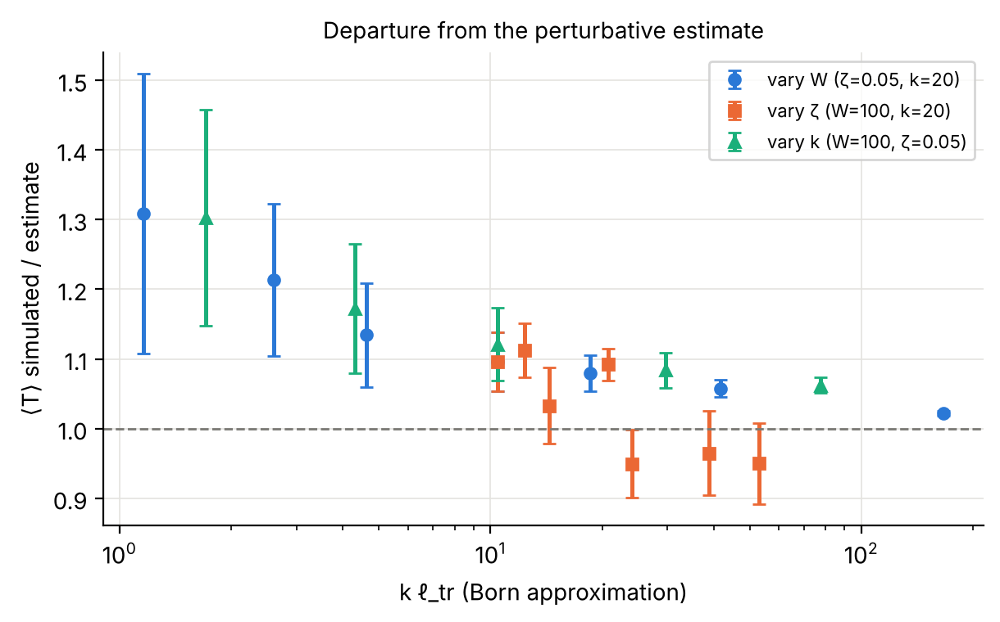

Ratio of the simulated ensemble-mean transmission to the parameter-free Born + diffusion estimate ⟨ℓ(k)/(L_d+ℓ(k))⟩ (averaged over the packet's momentum distribution, ℓ = (π/2)ℓ_tr), for all three sweeps, plotted against kℓ_tr. Error bars: 95% CI of the simulated mean (estimate has no error bar). The ratio approaches ~1.05 for weak scattering and grows to ~1.3 as kℓ_tr → 1, where the Born approximation is not expected to hold. Smooth disorder (kζ ≳ 2, points with ratio < 1) deviates in the opposite direction. The overall O(1) prefactor of the estimate is convention-dependent; the trend is the robust result. Data: results/transport/analysis.json.

## disorder_examples.png

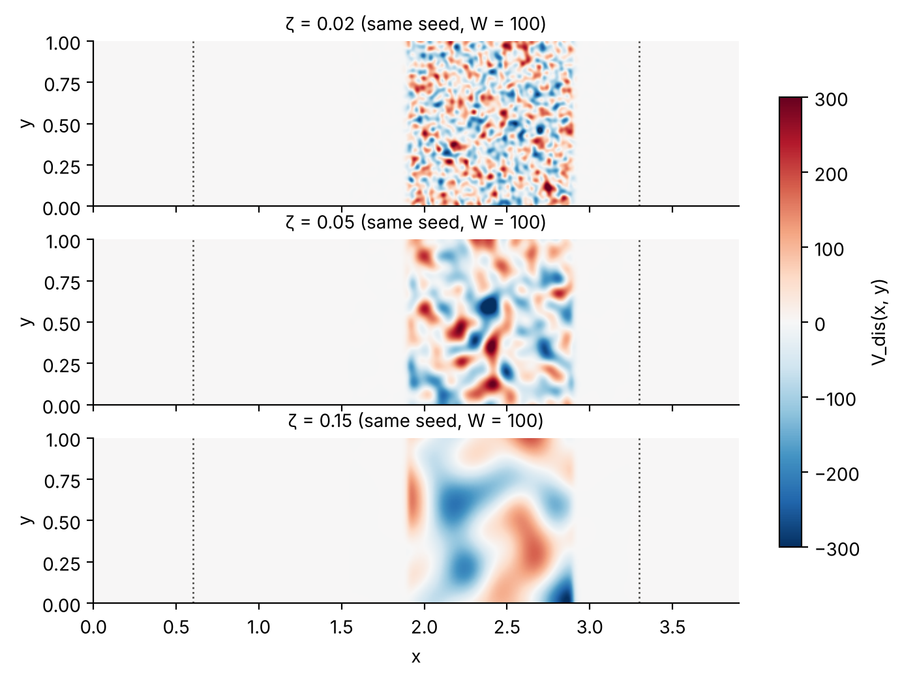

Disorder realizations (seed 0, RMS W = 100) for three correlation lengths in the waveguide geometry. Disorder is confined to the slab 1.9 < x < 2.9 by a smooth window; dotted lines mark the inner edges of the absorbing layers. The same seed gives the same random draw rescaled in ζ.

## localization_closed_box.png

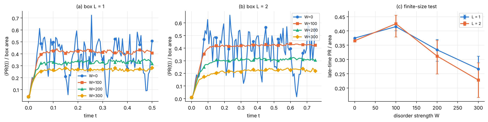

Participation ratio PR = (∫ρ)²/∫ρ² (effective occupied area) of a packet launched in a closed box with disorder (ζ = 0.05, kx0 = 20) for box sizes L = 1 and 2. (a,b) ensemble-mean PR/area vs time. (c) late-time (second half) average with 95% bootstrap CIs. Localization with ξ ≪ L would make PR/area drop by ~4x when L doubles; equal values indicate states extended over the box. W = 0 is a single deterministic run (no ensemble average), hence its large recurrences. Data: results/localization/.

## pinn_error_vs_time.png

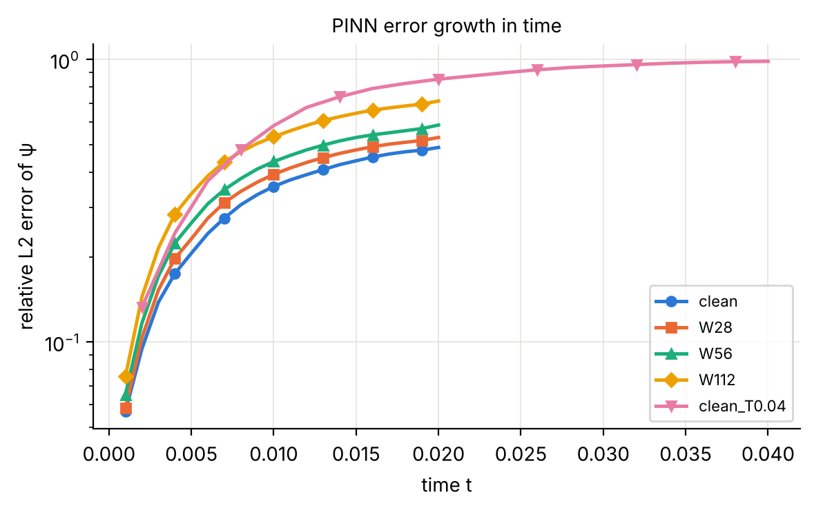

Relative L2 error of the PINN wavefunction vs time for clean and disordered potentials (ζ = 0.08) and for a doubled time window. Data: results/pinn/<run>/eval_timeseries.csv.

## pinn_errors.png

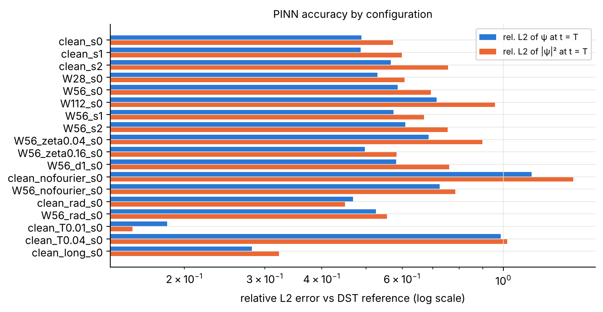

Final-time (t = T) relative L2 errors of every PINN run against the DST reference solution of the same configuration and disorder realization. W in units of the potential (E₀ = 112.5); s = network seed, d = disorder seed; nofourier = plain MLP; rad = residual-adaptive sampling; T0.04 = doubled time window. Data: results/pinn/summary.csv.

## pinn_vs_reference_W56.png

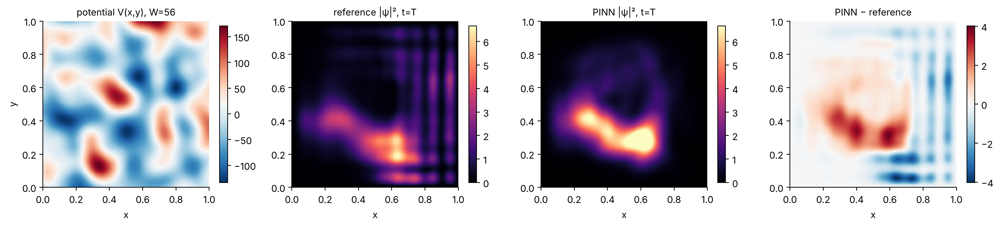

PINN vs DST reference for the disordered PINN problem (W = 56 = E₀/2, ζ = 0.08, disorder seed 0) at the final time T = 0.02. Both solvers use the identical potential realization.

## realization_convergence.png

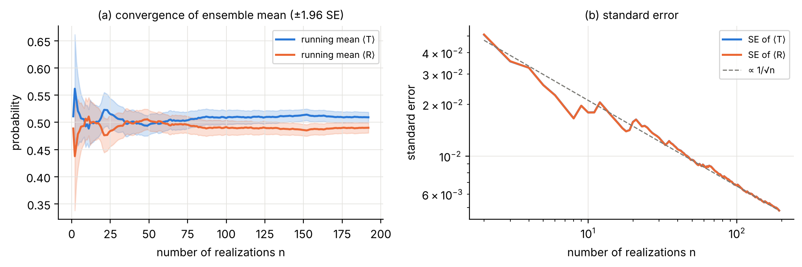

Convergence of ensemble averages with the number of independent disorder realizations (W = 100, ζ = 0.05, L_d = 1). (a) Running mean with ±1.96 SE band. (b) Standard error vs n follows 1/√n; the curves for T and R coincide because T + R ≈ 1 (P_in < 10⁻³). Data: results/transport/convergence/.

## transport_barrier.png

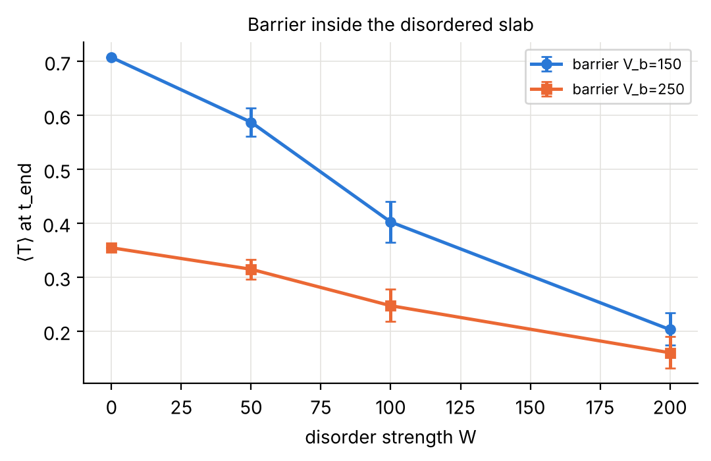

Transmission through a smooth rectangular barrier (width 0.1, centred in the slab) of height below (150) or above (250) the longitudinal energy kx0²/2 = 200, with added disorder (ζ = 0.05, L_d = 1). 95% bootstrap CIs. Data: results/transport/barrier/.

## transport_vs_correlation_length.png

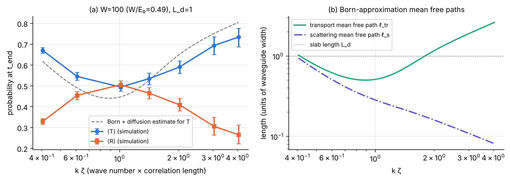

Effect of the disorder correlation length ζ at fixed RMS strength W = 100 (L_d = 1, kx0 = 20). (a) Ensemble-mean transmission and reflection with 95% bootstrap CIs vs kζ. Dashed: Born + diffusion estimate (not a fit). (b) Born-approximation mean free paths for Gaussian-correlated disorder in unbounded 2D: ℓ_tr is non-monotonic in ζ (white-noise limit ∝ ζ⁻², smooth limit ∝ ζ). Data: results/transport/corr_length/.

## transport_vs_length.png

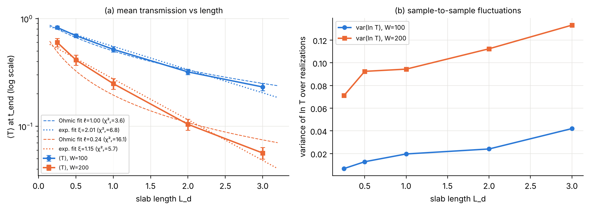

Transmission vs disordered-slab length (ζ = 0.05, kx0 = 20, 24 realizations per point, t_end = 1 + 0.5 L_d). (a) ⟨T⟩ with 95% bootstrap CIs (log scale) and weighted least-squares fits of the diffusive form ℓ/(L+ℓ) (dashed) and of an exponential A e^(−L/ξ) (dotted); χ²ᵣ = reduced chi-square. At W = 100 the diffusive form fits better; at W = 200 the exponential fits better, with ξ of the same order as the quasi-1D estimate Nℓ. (b) var(ln T): it stays ≪ |⟨ln T⟩|, unlike the broad distributions expected deep in the localized regime (the packet averages over a band of energies). Data: results/transport/length/, analysis.json.

## transport_vs_momentum.png

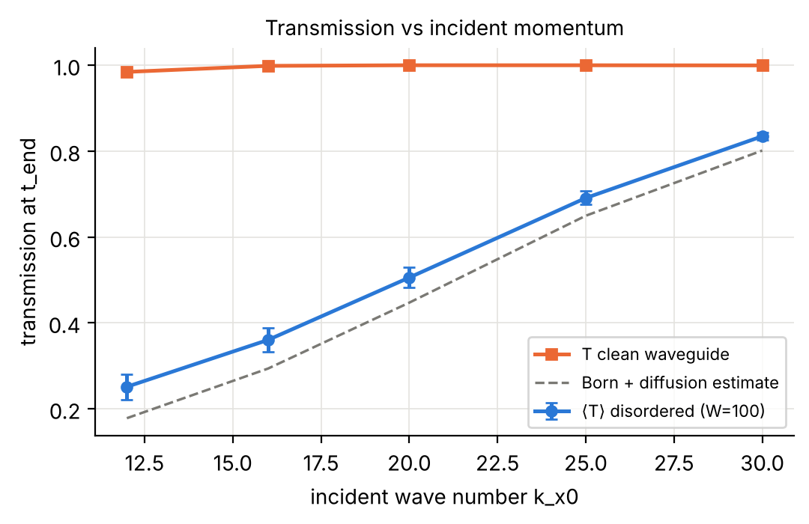

Transmission through the disordered slab (W = 100, ζ = 0.05, L_d = 1) vs incident wave number, with 95% bootstrap CIs; clean-waveguide values for comparison. Faster packets are scattered less (ℓ_tr grows with k). Data: results/transport/momentum/.

## transport_vs_strength.png

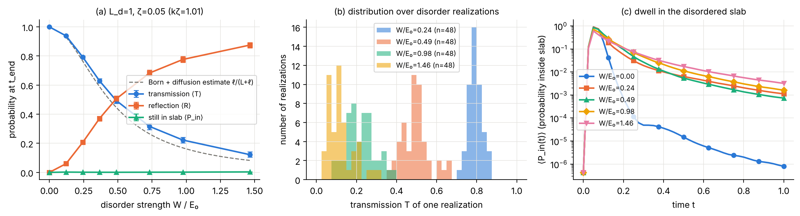

Wave-packet transport through a disordered slab (length L_d = 1, correlation length ζ = 0.05) in a hard-wall waveguide of width 1; incident transverse mode 1, kx0 = 20 (E₀ ≈ 205). (a) Ensemble means of transmission T, reflection R and probability remaining in the slab at t_end = 1, with 95% bootstrap confidence intervals over independent disorder realizations (n given in summary.csv). Dashed: order-of-magnitude estimate ℓ/(L_d+ℓ) with ℓ = (π/2)ℓ_tr from the 2D Born approximation (valid only for kℓ ≫ 1; not a fit). (b) Distribution of T over realizations. (c) Mean probability inside the slab vs time. Data: results/transport/strength/.

## validation_solver.png

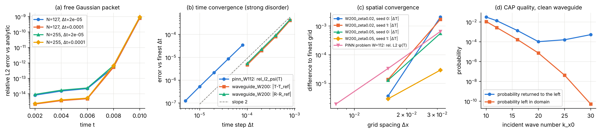

Validation of the DST split-step reference solver. (a) Relative L2 error against the exact free Gaussian packet (2x2 box, walls far from the packet). (b) Self-convergence in the time step with strong disorder; errors relative to the finest step; dashed line: slope 2 (Strang splitting is second order). PINN problem: wavefunction at t = T, W = E0 = 112.5; waveguide: T and R at t = 1, W = 200. (c) Spatial convergence: the same continuum disorder realization sampled on grids with dx = 1/32, 1/64 (production) and 1/128 (reference). (d) Spurious return from the complex absorbing potential for a free packet in the waveguide, vs incident wave number. Data: results/validation/.

## waveguide_snapshots.png

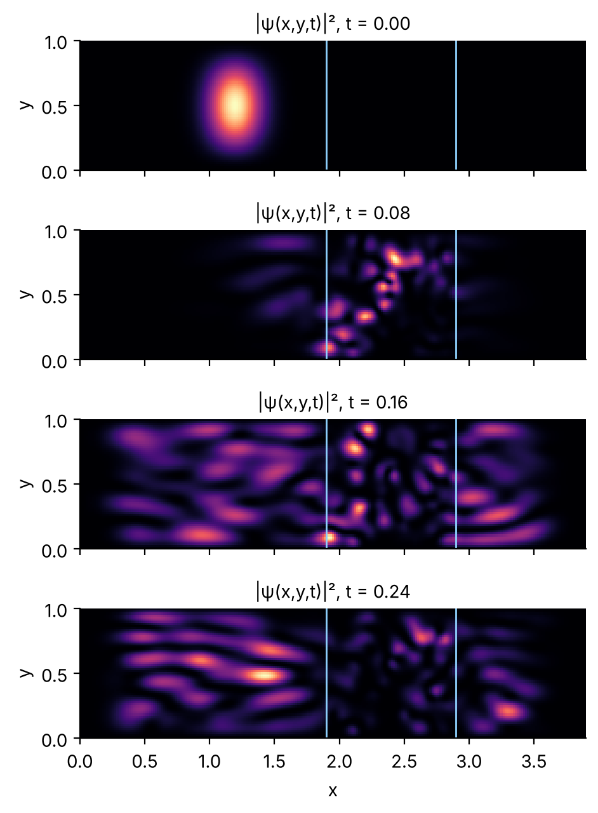

Probability density of one realization (W = 150, ζ = 0.05, seed 0) at four times. Light lines: slab edges. The packet is partly reflected and partly transmitted, and scattered into higher transverse modes inside the slab; outgoing waves are absorbed at both ends. Each panel has its own colour scale (zero = black). Reference solver, dx = 1/64.

